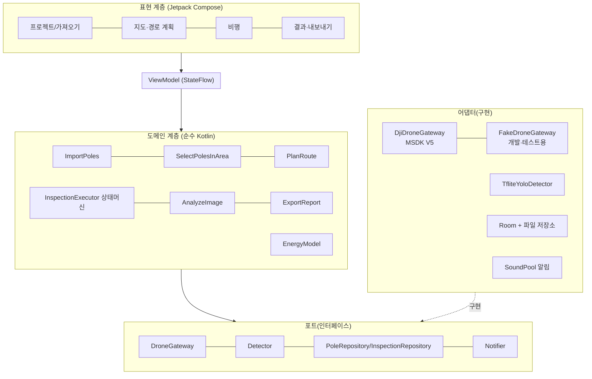

# 시스템 구성과 데이터 설계

> [설계서 목차](../DESIGN.md)의 일부입니다. 장 번호(예: 6.4)는 전체 설계서 기준이며 다른 문서에서 그대로 참조합니다.

---

## 3. 시스템 구성

### 3.1 전체 구성도

```
 [사무실 PC] ──(USB/SD: CSV, 모델, 지도 MBTiles)──►┌──────────────────────────────┐
                                                  │  DJI RC Pro Enterprise       │
 [VWorld 타일 서버] ──(사전 다운로드, 인터넷 시)───►│  ┌────────────────────────┐  │
                                                  │  │  전주 점검 앱            │  │
                                                  │  │  - MapLibre (오프라인)   │  │
                                                  │  │  - 경로 계획             │  │
                                                  │  │  - 비행 실행 상태머신     │  │
                                                  │  │  - YOLO(TFLite) 분석     │  │
                                                  │  │  - Room DB / 파일 저장   │  │
                                                  │  └──────────┬─────────────┘  │
                                                  │      MSDK V5 (LDM 활성화)     │
                                                  └─────────────┼────────────────┘
                                                                │ O3 Enterprise 무선 링크
                                                         ┌──────▼──────┐
                                                         │ Mavic 3E/3T │
                                                         └─────────────┘
```

### 3.2 계층 구조 (Clean Architecture + MVVM)



- **도메인 계층은 Android와 DJI에 의존하지 않는다.** 경로 계획과 상태머신을 JVM 단위 테스트로 검증할 수 있다.
- `DroneGateway`를 모의 구현(`FakeDroneGateway`)으로 바꾸면 에뮬레이터나 기체 없이도 UI와 흐름 전체를 개발할 수 있다. 현재 DJI SDK는 ARM 실기기에서만 동작한다.

### 3.3 모듈 구성 (Gradle 멀티 모듈)

| 모듈 | 종류 | 내용 |
|------|------|------|
| `:app` | Android app | `Application`(DJI 초기화, 수동 DI 조립), 내비게이션, 화면 조립 |
| `:core:model` | Kotlin/JVM | `Pole`, `Mission`, `Sortie`, `FlightParams`, `Detection` 등 도메인 모델 |
| `:core:domain` | Kotlin/JVM | 유스케이스, `InspectionExecutor`, 포트 인터페이스, CSV 파서(인코딩 판별 포함, 단위 테스트 대상) |
| `:core:route` | Kotlin/JVM | 좌표 변환, 다각형 포함 판정, TSP, 소티 분할, 에너지 모델 |
| `:core:data` | Android lib | Room DB, Excel 파서(2차), 파일 저장, DataStore 설정 |
| `:drone:dji` | Android lib | MSDK V5 어댑터(웨이포인트, 카메라, 미디어, 텔레메트리, LDM) |
| `:drone:fake` | Android lib | 모의 기체(시간 기반 위치 이동, 가짜 사진) |
| `:detector:tflite` | Android lib | YOLO TFLite 추론, 전처리/후처리 |
| `:feature:project` | Android lib | 프로젝트 목록, 데이터 가져오기 |
| `:feature:planner` | Android lib | 지도, 영역 그리기, 경로 미리보기, 파라미터 설정 |
| `:feature:flight` | Android lib | 비행 화면(FPV, 미니맵, 일시정지/재개, 상태) |
| `:feature:report` | Android lib | 결과 조회, 내보내기 |
| `:map` | Android lib | MapLibre 래퍼, 오프라인 타일 관리 |

> **1차는 3개 모듈로 시작한다**: `:app`(UI, 데이터, `FakeDroneGateway`, 탐지기는 패키지로 구분) + `:core`(JVM: model, domain, route 통합) + `:drone:dji`. 위 표의 세분화는 규모가 커질 때 `:core`와 `:app`에서 패키지 단위로 분리해 나간다. 기체 능력 차이(렌즈 목록, 줌)는 `DroneGateway`가 능력(capabilities)으로 노출해, 새 기체를 추가해도 도메인이 바뀌지 않게 한다.

**`:core` 패키지 구성(구현됨)**: `com.example.myfirstapp.core` 아래에 `model`(도메인 모델, `FlightParams` 검증), `port`(`DroneGateway`, `Detector`, `Notifier`, `StorageMonitor`, `InspectionRecorder`), `csv`(`PoleCsvParser`), `route`(투영, 다각형, `TspSolver`, `RoutePlanner`, `EnergyModel`), `executor`(`InspectionExecutor`, `PreflightEvaluator`), `fake`(`FakeDroneGateway`)를 둔다. `:app`의 `data` 패키지(구현됨)에는 Room `AppDatabase`와 `ProjectDao`(가져오기 트랜잭션)를 둔다. 화면 ①·②는 `:app`의 `ui/ProjectScreen.kt` 한 화면(왼쪽 목록, 오른쪽 가져오기)으로 구현했고, `InspectionApp`(`Application`)이 DB를 만든다. 지도는 `ui/MapScreen.kt`(MapLibre, `maps/*.mbtiles`를 모두 겹쳐 표시, 전주 클러스터링)이며, 글리프 파일이 없어 지도 위 글자는 그리지 않고 전주를 누르면 카드로 보여 준다. `FakeDroneGateway`는 순수 Kotlin이므로 `:app`이 아니라 `:core`에 두어 단위 테스트와 앱(에뮬레이터 시연)이 함께 쓴다.

### 3.4 기술 스택

| 영역 | 선택 | 비고 |
|------|------|------|
| 언어/UI | Kotlin, Jetpack Compose, Material3 | 기존 프로젝트 유지 |
| 아키텍처 | MVVM + Clean, Coroutines/Flow | |
| DI | 수동 DI(`Application`에서 조립) | Hilt는 AGP 9/KSP 호환 부담이 있어 1차 제외, 필요 시 도입 |
| DB | Room 2.8.5 (SQLite) + KSP 2.3.12 | 오프라인 저장. `:app`의 `data` 패키지 |
| 설정 | DataStore | 비행 파라미터 기본값 등 |
| 지도 | MapLibre Native Android 13.6.1(`android-sdk-opengl`) + VWorld 타일(MBTiles) | 오픈소스, 중국계 아님. 13.x 기본 패키지는 Vulkan이라 RC Pro·에뮬레이터 호환을 위해 OpenGL ES 패키지 사용 |
| 드론 | DJI MSDK V5 5.18.0 + UX SDK(FPV 위젯 등, 샘플 저장소 소스 활용) | [공식 샘플](https://github.com/dji-sdk/Mobile-SDK-Android-V5) 기준 |
| 탐지 | TensorFlow Lite 2.17 (+GPU delegate 선택) | |
| CSV | 자체 파서 또는 경량 라이브러리 | 인코딩 자동 판별 |
| Excel | fastexcel-reader 등 경량 라이브러리 (2차) | Apache POI는 무거움 |
| 알림음 | SoundPool + 사전 녹음 음성 파일 | RC Pro에 한국어 TTS 엔진이 없을 수 있음 |

---

## 4. 데이터 설계

### 4.1 전주 입력 파일 규격 (CSV)

```csv
pole_id,lat,lon,line_name,note
A-1234,37.123456,127.123456,OO선,비고
```

| 컬럼 | 필수 | 설명 |
|------|------|------|
| `pole_id` | ✅ | 전주번호(고유) |
| `lat`, `lon` | ✅ | WGS84 십진수 도 |
| `line_name` | | 선로명(지도 필터, 색상 구분) |
| `note` | | 기타 |

- 헤더 이름을 **자동 인식**한다(한글·영문 동의어: 전주번호/pole_id, 위도/lat 등). 인식에 실패할 때만 **컬럼 매핑 화면**을 띄운다(MVP 이후).
- 전주 높이 정보는 없다. 비행 고도는 사용자 설정값을 쓴다(6.3).

### 4.2 엔티티 (Room)

```mermaid
erDiagram
  PROJECT ||--o{ POLE : contains
  PROJECT ||--o{ MISSION : has
  MISSION ||--o{ SORTIE : "split into"
  SORTIE ||--o{ VISIT : "ordered visits"
  POLE ||--o{ VISIT : visited
  VISIT ||--o{ CAPTURE : photos
  CAPTURE ||--o{ DETECTION : results
  SORTIE ||--o{ FLIGHT_EVENT : "state log"
  SORTIE ||--o{ TELEMETRY_SAMPLE : "flight log"

  PROJECT { long id; string name; datetime createdAt }
  POLE { long id; long projectId; string poleId; double lat; double lon; string lineName; string note }
  MISSION { long id; long projectId; string areaGeoJson; json flightParams; string modelVersion; string status }
  SORTIE { long id; long missionId; int seq; double estDistanceM; double estBatteryPct; string status; datetime startedAt; datetime endedAt }
  VISIT { long id; long sortieId; long poleRowId; int order; string status; datetime arrivedAt; string skipReason }
  CAPTURE { long id; long visitId; string filePath; string lens; string source; double lat; double lon; double altRel; double gimbalPitch; double heading; datetime takenAt; bool originalDownloaded }
  DETECTION { long id; long captureId; string label; float score; float x; float y; float w; float h }
  FLIGHT_EVENT { long id; long sortieId; string fromState; string toState; string reason; long visitId; datetime at }
  TELEMETRY_SAMPLE { long id; long sortieId; datetime at; double lat; double lon; double altRel; float speed; int batteryPct; string flightMode }
```

- **구현 현황**: `PROJECT`, `POLE`만 구현했다(`POLE`은 `(projectId, poleId)` 고유, 프로젝트 삭제 시 함께 삭제). 나머지는 쓰는 단계(3·4단계)에서 추가하며, 출시 전이므로 스키마 버전은 1로 유지한다.
- `VISIT.status`: `PENDING` / `IN_PROGRESS` / `DONE` / `SKIPPED` / `FAILED`
- `CAPTURE.source`: `AUTO`(도착 시 자동), `MANUAL`(수동 촬영 버튼), `PERIODIC`(주기 분석 프레임)
- `MISSION.flightParams`에는 실행 시점의 파라미터를 그대로 저장한다(나중에 설정을 바꿔도 기록은 유지된다).
- 탐지 모델 버전을 기록해 어떤 모델로 분석했는지 추적한다.
- `FLIGHT_EVENT`: 상태머신의 모든 전이를 기록한다(6.4 복구용). `TELEMETRY_SAMPLE`: 1~2초 간격으로 기록하며 에너지 모델 보정(5.5)과 사후 분석에 쓴다.

### 4.3 파일 저장

```
<앱 전용 외부 저장소>/
├── maps/*.mbtiles              # 오프라인 지도
├── models/<version>/model.tflite, labels.txt, model.json
└── projects/<projectId>/missions/<missionId>/
    ├── images/<poleId>_<timestamp>_<lens>.jpg
    └── export/<missionId>.zip
```
