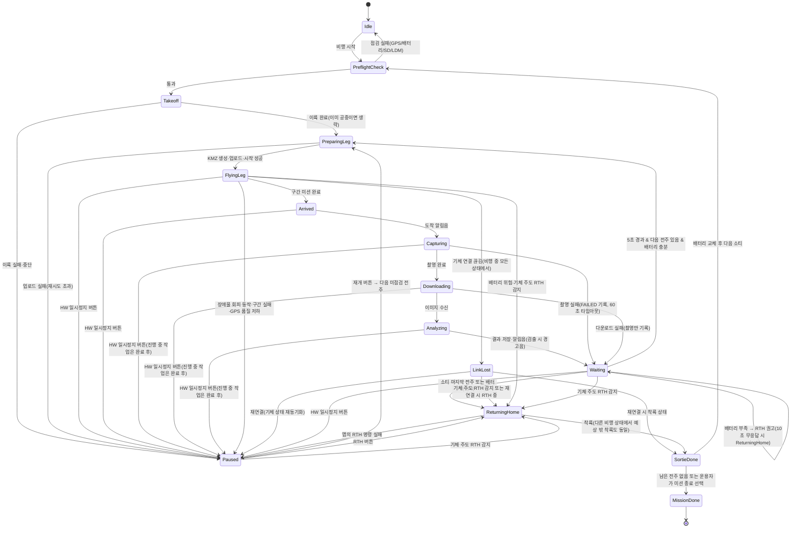

# 비행 실행 설계

> [설계서 목차](../DESIGN.md)의 일부입니다. 장 번호(예: 6.4)는 전체 설계서 기준이며 다른 문서에서 그대로 참조합니다.

---

## 6. 비행 실행 설계

### 6.1 비행 제어 방식 비교

| 방식 | 설명 | 장점 | 단점 |
|------|------|------|------|
| A. 소티 전체를 하나의 웨이포인트(KMZ) 미션으로 | 웨이포인트 동작(촬영, 호버)을 미션에 포함 | 업로드 1회, 통신 끊겨도 기체가 계속 수행 | 다운로드와 분석 시간이 가변적인데 호버 시간은 고정, 재개 시 **중단 지점으로 복귀**함, 앱 제어 제약 |
| **B. 구간(Leg) 단위 미니 미션 (권장)** | "현재 위치 → 다음 전주" 짧은 KMZ를 매번 생성·업로드·실행 | 도착 후 동작을 앱이 완전히 제어, 재개 시 **현재 위치에서 다음 전주로** 바로 이동, 요구사항과 정확히 일치 | 구간마다 업로드 지연(수 초), 구간 사이 호버 중에는 기체 기본 페일세이프에 의존 |
| C. Virtual Stick (앱이 직접 조종) | 앱이 속도 명령을 계속 전송 | 가장 유연함 | 앱이나 통신에 문제가 생기면 위험, 구현·검증 부담이 큼 → **제외** |

**결정: 방식 B를 기본으로 하고, 1단계 PoC에서 A와 비교 검증한다.** M3E에서 `startMission` 타임아웃 사례가 보고되어 있으므로([이슈 #394](https://github.com/dji-sdk/Mobile-SDK-Android-V5/issues/394)), PoC에서 업로드와 시작 지연, 재시도 정책을 반드시 측정한다.

### 6.2 구간 미션 생성

- `WPMZManager.generateKMZFile(...)`로 KMZ를 만들고 `checkValidation` → `WaypointMissionManager.pushKMZFileToAircraft` → `startMission` 순으로 진행한다.
- 구간 웨이포인트 구성(기본):
  1. (필요 시) 현재 위치 상공에서 **이동 고도**까지 상승
  2. 목표 전주의 점검 위치 상공, 이동 고도
  3. 점검 위치, **점검 고도**(이동 고도와 같으면 생략)
- 고도 기준은 **이륙 지점 기준 상대 고도**다. 지형 고저차 위험은 8장을 참고한다.
- **업로드·시작 재시도**: 실패 시 2초 간격으로 3회 재시도하고, 초과하면 `Paused`로 전환해 알린다.
- 미션 종료 동작은 호버(아무 동작 없음)다. 통신 상실 시 동작은 **RTH**다.
- 첫 구간은 지상에서 시작할 수 있다(미션 이륙 안전 고도 설정). 또는 운용자가 수동으로 이륙한 뒤 시작할 수 있다.

### 6.3 비행 파라미터 (사용자 설정)

| 파라미터 | 기본값 | 범위/비고 |
|----------|--------|-----------|
| 이동 고도 | 50m | 30–120m(RTH 고도 여유 10m를 두고 150m 상한 준수). 장애물(수목, 건물, 전선) 위로 |
| 점검 고도 | 30m | 전주(약 10–16m) + 여유. 이동 고도 이하 |
| 비행 속도 | 8 m/s | 2–15 m/s |
| 점검 위치 | 전주 바로 위 | 또는 오프셋(거리 m, 방위각°) |
| 짐벌 피치 | -90° (수직 하향) | -90 ~ 0° |
| 촬영 렌즈 | 광각 + 망원 | M3T는 열화상 추가 |
| 망원 배율 | 7× | |
| 도착 후 대기 | 5초 | 분석과 알림이 끝난 뒤부터 계산 |
| 배터리 예비율 | 30% | |
| RTH 고도 | 이동 고도 + 10m (**최대 150m**) | |
| 가시권 반경 | 500m | |
| 다운로드 방식 | 미리보기(빠름) | 원본 / 미리보기 (6.6) |

프리셋(예: "일반 배전", "도심")으로 저장해 재사용한다.

**고도 제한과 장애물 회피**

- 모든 고도 입력(이동, 점검, RTH)은 **150m 이하**로 검증한다. 초과 입력은 거부한다.
- 전주 높이와 주변 환경 정보가 없으므로 **기체 장애물 회피를 필수**로 한다(비행 전 점검에서 꺼져 있으면 시작 차단, 6.7).
- 다만 장애물 감지 센서는 **가는 전선을 놓칠 수 있다**. 회피 기능은 보조 수단이며, 전선과 수목 위로 넘는 것은 이동 고도 설정이 담당한다. 계획 화면에 이 경고를 표시한다.
- 회피가 동작해 미션이 멈추거나 우회하면 `FlyingLeg`에서 `Paused`로 전환하고 운용자에게 알린다(PoC ⑧에서 M3E의 미션 중 회피 동작 방식(제동/우회)을 확인).

### 6.4 실행 상태머신 (`InspectionExecutor`)



**일시정지/재개 규칙**

- **일시정지의 1차 수단은 RC Pro의 하드웨어 일시정지 버튼**이다. 버튼을 누르면 기체가 미션을 일시정지하고 제자리 호버하며, 이는 앱의 상태와 무관하게 동작한다. 앱은 비행 모드 텔레메트리로 이를 감지해 즉시 `Paused`로 동기화한다(대기 시간 1초 이내를 PoC ⑥에서 확인). 이때부터 운용자가 RC 스틱으로 조종하고 앱에서 짐벌, 줌, 수동 촬영을 한다. 측면 사선처럼 자동 촬영에 없는 각도가 필요하면 이 상태에서 기체를 움직여 직접 촬영하며, 사진은 현재 전주에 `source=MANUAL`로 연결된다. 화면의 [일시정지] 버튼은 보조 수단(`stopMission`)이다.
- **재개도 하드웨어 버튼을 1순위로 한다.** 다만 재개는 앱이 새 구간 미션을 만드는 동작이라, 하드웨어 버튼 입력을 앱이 받아야 한다. 후보는 ① C1/C2 커스텀 버튼을 [재개]에 매핑 ② 일시정지 버튼 재누름(토글)을 텔레메트리/키 이벤트로 감지, 두 가지이며 **PoC ⑥에서 가능한 방식을 확인해 확정**한다. 둘 다 불가능하면 화면의 큰 [재개] 버튼을 사용한다(보조 수단으로는 항상 제공).
- **재개**를 누르면 "다음 미점검 전주"를 계산해 **현재 위치 기준으로** 새 구간 미션을 시작한다.
  - 목표 전주로 가던 중(도착 전)에 멈췄다면, 그 전주가 여전히 다음 전주다.
  - 도착 후 **촬영 전**에 멈췄다면, 그 전주는 아직 미점검이다. 재개하면 현재 위치에서 그 전주로 다시 가서 촬영부터 수행한다(운용자가 수동 촬영을 하면 그 결과로 완료 처리).
  - 촬영 이후(다운로드, 분석, 대기 중)에 멈췄다면, 사진이 있으므로 현재 전주는 완료 처리되고 그다음 전주로 간다.
  - 어느 경우든 **사진이 없는 전주를 `DONE`으로 처리하지 않는다.** 사진 없이 넘기려면 `SKIPPED`를 쓴다.
- 일시정지 중에 쓸 수 있는 동작: **건너뛰기**(현재 목표를 SKIPPED로), **이 전주 완료 처리**, **다시 계획**(현재 위치 기준으로 남은 순서 재계산).
- 하드웨어 일시정지 후 재개할 때는 남아 있는 기존 미션을 `stopMission`으로 먼저 종료한 뒤 새 구간 미션을 올린다(기체는 미션을 *일시정지*했을 뿐 종료하지 않았기 때문).
- **기체 주도 RTH·착륙**(저전압, 통신 상실, 운용자의 RC RTH 버튼)은 앱 상태와 무관하게 발생할 수 있다. 앱은 비행 모드 텔레메트리로 이를 감지해 `ReturningHome`으로 전환하고, 이후 자동 구간 명령을 보내지 않는다.
- 미션 종료(남은 전주를 포기)는 착륙 후 `SortieDone`에서 운용자가 선택한다.
- **연결 끊김(`LinkLost`)**: 텔레메트리가 3초 이상 끊기면 진입한다. 이 동안 새 명령을 보내지 않고 화면에 경고를 표시한다. 재연결하면 기체의 비행 모드와 위치를 읽어 상태를 다시 맞추고 `Paused`로 복귀한다. 그동안 기체는 자체 페일세이프(RTH)를 따른다.
- **GPS 품질 저하**: 비행 중 GPS 등급이 기준 아래로 떨어지면 `Paused`로 전환하고 경고한다.
- **RTH 권고**(5.5): 대기 종료 시 배터리 검증에 실패하거나 구간 비행 중 감시 조건에 걸리면 경고음과 10초 카운트다운을 띄운다. 운용자가 RTH를 누르면 즉시, 무응답이면 10초 뒤 RTH한다. 하드웨어 일시정지로 `Paused`가 되면 권고는 취소된다(운용자가 조종을 넘겨받음). 재개할 때도 같은 배터리 검증을 하며, 부족하면 재개를 거부하고 RTH를 안내한다.
- **구현 방식**: `InspectionExecutor`는 모든 입력(명령, 기체 이벤트, 텔레메트리, 작업 결과)을 한 채널에서 순서대로 처리한다. 상태마다 오래 걸리는 작업은 하나의 작업(step)으로 실행하고, 상태가 바뀌면 취소하며 늦게 도착한 결과는 세대 번호로 버린다. 작업 중 예외는 `Paused`로 전환해 알린다. 연결 끊김 3초 판정과 비행 모드 해석은 어댑터(`DroneGateway`)가 한다.

**복구**: 모든 상태 전이를 DB에 기록한다. 앱이 재시작되면 기체 상태(비행 중 여부, 위치)와 DB의 마지막 상태를 비교해 `Paused` 상태로 복귀하고 운용자에게 재개 여부를 묻는다. 이때 **DB의 촬영 기록과 카메라 SD의 미디어 목록을 대조**해, 이미 찍은 전주를 다시 촬영하지 않게 한다.

### 6.5 도착 후 처리 절차

```
Arrived ─► (짐벌 피치·렌즈·줌 설정) ─► 촬영(광각, 망원 순) ─► 사진 다운로드
        ─► YOLO 분석 ─► DB 저장 ─► 알림음(검출 없음: "점검 완료" / 검출: 경고음 + "검출")
        ─► 5초 대기(화면에 카운트다운과 결과 썸네일 표시) ─► 다음 구간
```

- 이 과정 전체의 타임아웃은 60초다. 다운로드나 분석이 실패하면 촬영 사실만 기록하고(`originalDownloaded=false`) 다음 전주로 진행한다. 비행 후 일괄 다운로드로 보완한다.
- 촬영 위치, 고도, 짐벌 각도, 기수 방향을 캡처 메타데이터로 저장한다.
- **탐지기 실패는 비행을 막지 않는다.** 모델 로드나 추론이 실패하면(예외, 메모리 부족) 분석만 건너뛰고 촬영 기록은 남기며 화면에 경고한다.
- 구간을 시작할 때마다 SD 카드와 조종기 저장 공간을 확인하고, 기준 미만이면 `Paused`로 전환한다.

### 6.6 이미지 획득 방법

| 방법 | API | 해상도 | 속도 | 용도 |
|------|-----|--------|------|------|
| 사진 미리보기 다운로드 | `MediaDataCenter` / MediaManager 미리보기 | 중간 | 빠름 | **비행 중 자동 분석 (기본)** |
| 사진 원본 다운로드 | `pullOriginalMediaFileFromCamera` | 20MP(광각) / 12MP(망원) | 느림(수 초~수십 초) | 비행 중(선택) 또는 비행 후 정밀 분석 |
| 라이브 영상 프레임 | `CameraStreamManager.addFrameListener` (NV21) | 스트림 해상도 | 즉시 | 주기 분석(F-13), 수동 조종 중 분석 |

> 원본 다운로드 속도는 PoC에서 측정한 뒤 기본값을 확정한다. 원본은 SD 카드에 남아 있으므로 비행 후 일괄 다운로드할 수 있다.

### 6.7 비행 전 점검 (PreflightCheck)

판정은 `PreflightEvaluator`가 하며 기준값은 초기값이다(필드 테스트로 조정): GPS 위성 12개·등급 4 이상, SD 여유 1GB 이상, 배터리 온도 15–50℃, 배터리 ≥ 소티 예상 소모 + 예비율.

- 기체 연결, GPS 위성 수와 신호 등급, 홈 포인트 기록 여부
- 배터리 잔량과 이번 소티 예상 소모량 비교, 배터리 온도
- SD 카드 여유 공간
- LDM 활성화 여부(7장)
- **장애물 회피 활성화(꺼져 있으면 시작 차단)**, RTH 고도(150m 이하), 통신 상실 동작(RTH) 설정 확인
- 이륙 지점과 첫 전주 사이 거리가 가시권 반경 이내인지(VLOS 전용, BVLOS 미지원)
- **하드웨어 일시정지 버튼 시험**(체크리스트: 이륙 후 호버 중 눌러 기체가 멈추고 앱이 `Paused`로 바뀌는지 확인)
- 운용자 체크리스트 확인(비행 승인, 주변 안전)
