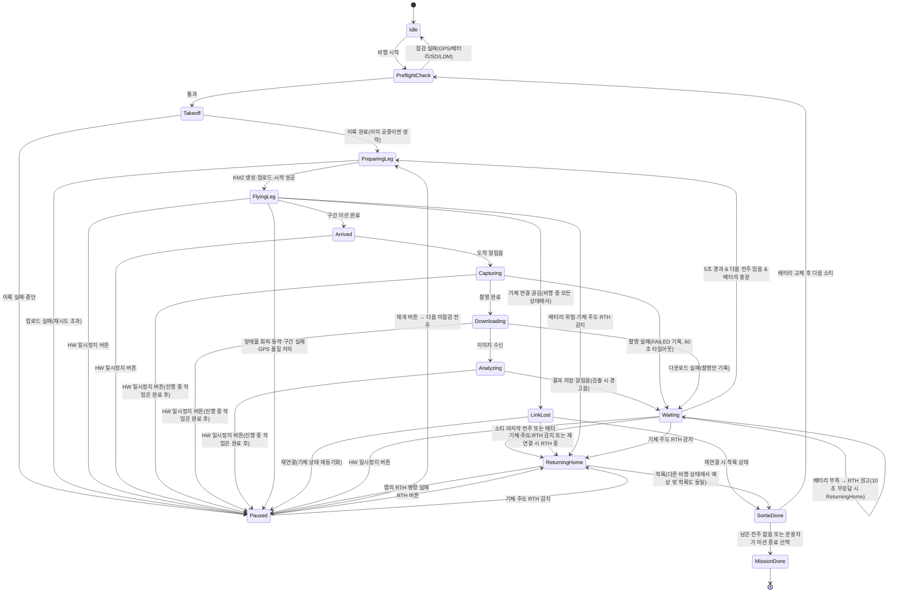

# 비행 실행 설계

> [설계서 목차](../DESIGN.md)의 일부입니다. 장 번호(예: 6.4)는 전체 설계서 기준이며 다른 문서에서 그대로 참조합니다.

---

## 6. 비행 실행 설계

### 6.1 비행 제어 방식 비교

| 방식 | 설명 | 장점 | 단점 |
|------|------|------|------|
| A. 소티 전체를 하나의 웨이포인트(KMZ) 미션으로 | 웨이포인트 동작(촬영, 호버)을 미션에 포함 | 업로드 1회, 통신 끊겨도 기체가 계속 수행 | 다운로드와 분석 시간이 가변적인데 호버 시간은 고정, 재개 시 **중단 지점으로 복귀**함, 앱 제어 제약 |
| **B. 구간(Leg) 단위 미니 미션 (권장)** | "현재 위치 → 다음 전주" 짧은 KMZ를 매번 생성·업로드·실행 | 도착 후 동작을 앱이 완전히 제어, 재개 시 **현재 위치에서 다음 전주로** 바로 이동, 요구사항과 정확히 일치 | 구간마다 업로드 지연(수 초), 구간 사이 호버 중에는 기체 기본 페일세이프에 의존 |
| C. Virtual Stick (앱이 직접 조종) | 앱이 속도 명령을 계속 전송 | 가장 유연함 | 앱이나 통신에 문제가 생기면 위험, 구현·검증 부담이 큼 → **제외** |

**결정(2026-10-30 PoC ①·⑥ 뒤 변경): 방식 A를 1차 기본으로 한다.** 시뮬레이터에서 소티 KMZ 업로드 약 1.2초, 일시정지 버튼으로 즉시 멈춤, C1 → `resumeMission`으로 재개했다. 수동 조종 뒤 재개하면 중단 지점으로 되돌아갔다가 이어 가는데(약 12초 더 걸림), 사용자가 이 동작을 받아들였다. 방식 B("현재 위치에서 다음 전주로")는 나중에 설정(비행 기본값)에서 A/B를 고를 수 있게 한다. 상태머신(6.3)은 그대로 두고, 미션을 올리는 단위(소티 1개 / 구간 1개)와 재개 동작만 `DroneGateway` 구현 안에서 바꾼다(`docs/evidence/2026-10-30-aircraft-poc`). 방식 A는 **멈추지 않고 계속 비행**한다(2026-10-30 사용자 결정): 지점마다 KMZ 동작(짐벌 → 촬영)으로 찍고 다음 지점으로 가며, 앱은 사진 이벤트마다 다운로드 → 탐지 → 저장 → 알림을 비행과 병렬로 처리한다(검출 알림은 몇 초 늦음). 더 보려면 운용자가 일시정지 버튼으로 멈추고 수동으로 본다. 이전 결정: 방식 B를 기본으로 하고 PoC에서 A와 비교 검증한다. M3E에서 `startMission` 타임아웃 사례가 보고되어 있으므로([이슈 #394](https://github.com/dji-sdk/Mobile-SDK-Android-V5/issues/394)), PoC에서 업로드와 시작 지연, 재시도 정책을 반드시 측정한다.

### 6.2 미션 생성

- **방식 A(기본)**: 소티의 전주를 촬영 지점으로 펼치고(`Viewpoints.expand`, 5.6) 긴 구간에 이동 고도 지점(촬영 없음)을 끼운 뒤(5.6) `WpmlWriter`로 소티 KMZ 하나를 만들어 `pushKMZFileToAircraft` → `startMission`. SDK `WPMZManager` 대신 직접 쓰는 이유: 현장에서 M3E로 날았던 KMZ와 같은 형식을 `:core`에서 만들고 단위 테스트할 수 있다(2026-10-30 시뮬레이터에서 40지점 확인). 사진 파일 이름 끝(`fileSuffix`)에 `전주번호_지점번호`를 붙인다. 완료 동작은 RTH(goHome).
- 아래는 **방식 B(선택지)** 구간 미션이다. `WPMZManager.generateKMZFile(...)`로 KMZ를 만들고 `checkValidation` → `WaypointMissionManager.pushKMZFileToAircraft` → `startMission` 순으로 진행한다.
- 구간 웨이포인트 구성(기본):
  1. (필요 시) 현재 위치 상공에서 **이동 고도**까지 상승
  2. 목표 전주의 점검 위치 상공, 이동 고도
  3. 점검 위치, **점검 고도**(이동 고도와 같으면 생략)
- 고도 기준은 방식 A에서 **실시간 지형 추적(지면 기준, 기본)** 또는 이륙 지점 기준이다(6.3, 5.6). 방식 B는 이륙 지점 기준 상대 고도다. 지형 고저차 위험은 8장을 참고한다.
- **업로드·시작 재시도**: 실패 시 2초 간격으로 3회 재시도하고, 초과하면 `Paused`로 전환해 알린다.
- 미션 종료 동작은 호버(아무 동작 없음)다. 통신 상실 시 동작은 **RTH**다.
- 첫 구간은 지상에서 시작할 수 있다(미션 이륙 안전 고도 설정). 또는 운용자가 수동으로 이륙한 뒤 시작할 수 있다.

### 6.3 비행 파라미터 (사용자 설정)

| 파라미터 | 기본값 | 범위/비고 |
|----------|--------|-----------|
| 이동 고도 | 50m | 30–120m(RTH 고도 여유 10m를 두고 150m 상한 준수). 장애물(수목, 건물, 전선) 위로. 방식 A는 150m(`transitLegThresholdM`, 2026-11-04)보다 긴 구간·이륙 뒤 첫 구간·복귀에 쓴다(5.6) |
| 점검 고도 | 30m | 전주(약 10–16m) + 여유. 이동 고도 이하 |
| 실시간 지형 추적 | 켬 | 2026-10-30 사용자 결정. 켜면 모든 웨이포인트 고도가 지면 기준(`realTimeFollowSurface`), 끄면 이륙 지점 기준. 5.6. 현장 PoC 전 |
| 비행 속도 | 8 m/s | 1.0–15.0 m/s, 0.5 단위(Pilot 2 체크리스트와 같음, 2026-11-04. 계획 화면 ±는 1 단위) |
| 점검 위치 | 전주 바로 위 | 또는 오프셋(거리 m, 방위각°) |
| 짐벌 피치 | -90° (수직 하향) | -90 ~ 0° |
| 촬영 렌즈 | 광각 + 망원 | M3T는 열화상 추가. 방식 A는 렌즈마다 촬영 동작을 따로 둔다(2026-11-04, 5.6. `wide,zoom` 한 동작은 실기체에서 1장). 같은 지점의 n번째 파일을 n번째 동작으로 보고, 파일 이름 끝(`_W`/`_Z`)이 있으면 그것을 먼저 본다 |
| 망원 배율 | 7× | 방식 A는 미션 올리기 전에 어댑터가 맞추고, 일시정지 중 바꿨으면 재개 전에 되돌린다 |
| 도착 후 대기 | 5초 | 분석과 알림이 끝난 뒤부터 계산 |
| 배터리 예비율 | 30% | |
| RTH 고도 | 이동 고도 + 10m (**최대 150m**) | |
| 가시권 반경 | 2,000m | 100m 단위 설정(2026-10-30 사용자 지정, 처음 500m) |
| 다운로드 방식 | 미리보기(빠름) | 원본 / 미리보기 (6.6) |

프리셋(예: "일반 배전", "도심")으로 저장해 재사용한다.

**고도 제한과 장애물 회피**

- 모든 고도 입력(이동, 점검, RTH)은 **150m 이하**로 검증한다. 초과 입력은 거부한다.
- 전주 높이와 주변 환경 정보가 없으므로 **기체 장애물 회피를 필수**로 한다(비행 전 점검에서 꺼져 있으면 시작 차단, 6.7).
- 다만 장애물 감지 센서는 **가는 전선을 놓칠 수 있다**. 회피 기능은 보조 수단이며, 전선과 수목 위로 넘는 것은 이동 고도 설정이 담당한다. 계획 화면에 이 경고를 표시한다.
- 회피가 동작해 미션이 멈추거나 우회하면 `FlyingLeg`에서 `Paused`로 전환하고 운용자에게 알린다(PoC ⑧에서 M3E의 미션 중 회피 동작 방식(제동/우회)을 확인).

### 6.4 실행 상태머신 (`InspectionExecutor`)



**방식 A 흐름(기본, 2026-10-30)**: 위 그림은 방식 B다. 방식 A는 같은 상태를 이렇게 쓴다.

- `PreparingLeg`: 소티의 남은 전주 전체로 KMZ를 만들어 `startSortie` 한 번 → `FlyingLeg`("임무 비행").
- **체크리스트 두 단계(10.5.5, 2026-11-04)**: [비행 임무 업로드] = `Command.Upload`(체크리스트 파라미터) → `PreflightCheck` → `PreparingLeg`(이륙 없이 `uploadSortie`) → `Uploaded`(땅, 대기). [시작] = `Start` → `Takeoff` → `PreparingLeg`(`startUploaded`만) → `FlyingLeg`. [업로드 취소] `CancelUpload` → `Idle`. 시작 거절은 땅이므로 `Idle`(지형 추적이면 이륙 기준을 묻고 한 번에 다시 올림). 재개·복구·이륙 기준 다시 올리기는 한 번에(`startSortie` = 올리기 + 시작). 완료 동작이 RTH가 아니면 `MissionFinished` 뒤 `Paused`(착륙하면 `SortieDone`).
- `FlyingLeg`에 머무는 동안 기체가 지점마다 찍는다. `WaypointReached`로 그 전주를 `IN_PROGRESS`로, `PhotoTaken`마다 사진 처리(다운로드 → 저장 → 탐지 → 기록·알림음)를 비행과 병렬로 차례차례 한다. 전주의 모든 지점 사진이 기록되면 `DONE`. 사진이 하나도 없는 전주는 `DONE`이 아니다(`FAILED`).
- 일시정지: RC 버튼은 펌웨어가 멈춤(`PausedByRc`), 화면 버튼은 `pauseMission`. 재개: `resumeMission`(중단 지점으로 돌아가 이어 감). 건너뛰기·완료 처리는 기록만 바꾸고 미션은 그대로다.
- `MissionFinished`(마지막 지점 뒤 RTH 시작) → `ReturningHome` → 착륙 → `SortieDone`. 남은 사진 처리는 착륙 뒤에도 끝까지 한다.
- 수동 촬영(일시정지 중)은 지금처럼 `capture` → `download` 경로를 쓴다. 앱 촬영은 어댑터가 하나씩 한다(화면 셔터와 RC 셔터가 겹치면 둘 다 같은 첫 새 사진 알림을 받아 하나를 잃기 때문, 11-04). 새 사진 알림은 촬영 명령을 보내기 전에 구독한다.
- **RC 셔터·녹화 버튼(2026-11-04 고침)**: 앱이 찍고 녹화한다. 10-30에는 "기체가 직접 찍는다"고 가정했으나 2026-11-03 현장에서 셔터를 3번 눌러도 새 사진이 없었다(MSDK 앱에서는 펌웨어가 찍지 않음). 그래서 RC 셔터는 화면 셔터와 같은 `capture` → `download` 경로를 쓰고, 녹화 버튼은 화면 녹화 버튼과 같다. 셔터 사진 따로 가르기(`ShutterPhoto`)는 없앤다.
- **사진 주인 가르기**(`:core` `MediaClassifier`, 어댑터가 새 사진 알림 `KeyNewlyGeneratedMediaFile`마다): ① 앱이 찍는 촬영(`capture`, 화면·RC 셔터) 중 첫 파일은 그 촬영 것(타이머는 끝날 때까지 모두) ② 카메라가 인터벌 모드라고 알리는 동안(`KeyCameraMode`, 멈춤 실패·앱 재시작으로 타이머가 남아도)과, 미션 중 타이머가 끝난 뒤 미션을 시작·재개하거나 새 소티를 올릴 때까지는 앱 촬영 것(11-04 리뷰: 일시정지 중 새 지점에 도착해 있으면 늦은 타이머 파일이 그 지점 0번 자리를 차지해 뒤 사진이 밀렸다) ③ 미션 중이면 지금 촬영 지점(이동 고도 지점은 앞 촬영 지점으로 셈, `shotIndex`)의 지점 사진(`PhotoTaken`) ④ 앱 촬영 직후 1.5초 안의 둘째 파일은 그 촬영 것(기록하지 않음) ⑤ 나머지는 넘기지 않는다. **지점 사진 순서**: 지점마다 오는 파일 수는 그 지점의 촬영 동작 수(렌즈별 동작, 설비 사진 포함)로 정한다. 렌즈 설정이 거절된 소티는 동작당 1장으로 본다(2026-11-03 현장: 2장을 기다리다 다음 지점 사진을 앞 지점의 둘째 파일로 붙임). 보통은 지금 지점 것이다. 다음 지점에 도착한 뒤 1초(`Tuning.Photo.LATE_FILE_MS`) 안에 온 파일은 렌즈를 알고(파일 종류 `dcf_type`) 앞 지점에 그 렌즈 자리가 비어 있으며 지금 지점이 다음에 기다리는 렌즈가 아닐 때만 앞 지점 것으로 본다. 렌즈를 모르면(`_V`) 앞 지점 파일 하나를 잃더라도 지금 지점 것이다(11-04: 11-03 현장에서 지점 사진은 도착 0.5~0.8초 뒤에 와서, 옛 규칙은 앞 지점 파일 하나가 빠지면 소티 끝까지 한 칸씩 밀렸다). 파일 이름의 `fileSuffix`(전주_지점)는 KMZ에 넣지만 실제 이름에 붙지 않아(10-31·11-03 `DJI_<시각>_<번호>_V.JPG`) 쓰지 않는다. 렌즈별 동작 소티는 시작 전에 카메라 "사진 저장"(`KeyCaptureCameraStreamSettings`)을 읽어 로그에 남기고, 여러 렌즈면 광각 하나로 바꾼다. 못 바꾸면 동작마다 그 설정의 렌즈 파일이 온다고 본다(실패해도 미션은 간다). 일시정지 중 앱 촬영이 사진 알림 없이 끝나면(시간 초과) 늦게 온 그 파일은 지점 사진으로 넘기지 않는다(재개하면 더 기다리지 않음). 이미 "사진 없음"으로 정리한 전주에 늦은 사진이 오면 완료로 고친다. 미션을 끝내거나 멈춘 뒤에도 5초 동안 지점 사진을 받는다. 받은 파일 이름은 운용 로그에 남긴다.
- **떠 있을 때 RC 셔터**(일시정지·수동 조종 중): 기체 위치에서 20m(`Tuning.Photo.SHUTTER_POLE_LINK_M`) 안의 가장 가까운 이번 실행의 남은 전주에 `source=MANUAL`(지점 없음)로 기록하고, 자동 사진과 같은 처리 줄(다운로드 → 탐지)에 넣는다. 전주 상태는 바꾸지 않고 완료 판정에 세지 않는다. 20m 안에 전주가 없으면 "셔터 사진을 연결할 전주가 없습니다(사진은 SD 카드에 있음)"를 띄운다. 미션 비행 중(자동 촬영 중)에는 화면·RC 셔터를 받지 않는다(지점 사진과 섞임). **미션 화면의 땅 위·RTH 중 셔터**(11-04, Pilot 2처럼 찍음)는 실행기를 거치지 않고 아래 수동 비행 셔터와 같은 수동 사진 경로로 찍는다(이 미션의 모든 전주 중 20m 안, 없으면 기타). 갈 곳은 `:core` `shutterRoute`(일시정지·떠 있는 대기 → 실행기, 자동 비행 → 막음, 그 밖 → 수동 사진 경로). 미션을 끝내거나 멈춘 뒤 5초(늦은 지점 사진 유예, `missionPhotosPending`) 동안은 셔터·타이머 시작을 막고 안내문을 띄운다(그 사이 찍으면 늦게 온 마지막 전주 사진을 셔터 사진으로 가져감, 11-04 리뷰).
- **수동 비행 화면(10.0)의 셔터**(화면 버튼·RC 셔터, 녹화 버튼 포함): 원본을 받은 뒤, 남은 전주가 있는 가장 최근 미션의 **모든 전주** 중 기체에서 20m 안의 가장 가까운 전주가 있으면 그 방문에 `MANUAL` 사진으로 기록하고 미션 `images/`에 둔다(4.3 이름 규칙, 지점 `m`). 없으면 `manual/<날짜>/manual_<시각>_<사진번호>_<렌즈>.jpg`. 판정은 `:core` `shutterLinkTarget`. 전주 상태는 바꾸지 않는다. **타이머 사진**(촬영 모드 메뉴, 10.5.7)도 두 화면 모두 사진마다 이 경로로 받는다(`ManualPhotos`). 앱 촬영 사진 받기는 하나씩, 기다리는 지점 사진 받기 뒤에 한다(재개 뒤 지점 사진이 타이머 사진 수십 장 뒤에 줄 서지 않게). 타이머 멈춤은 카메라가 인터벌을 벗어나야(사진 모드 되돌림이 받아져야) 끝난다. 거절되면(연결 끊김·응답 없음) 타이머는 계속 돌고(화면도 타이머 중) 안내문을 띄우며, 셔터를 다시 누르면 다시 멈춰 본다. 재개·업로드·시작은 타이머가 끝날 때까지(늦은 파일 1.5초 포함) 시간 제한 없이 기다리고 못 멈추면 하지 않는다. **카메라 모드 맞추기**: 어댑터는 소티 올리기·시작·재개 직전에 카메라가 단일 사진(`PHOTO_NORMAL`)이 아니면(Pilot 2·SMART·타이머가 남김, 앱 재시작) 바꾸고(인터벌이면 촬영을 먼저 멈춤), 타이머가 돌거나 못 바꾸면 `CameraNotReady`로 거절한다(안내 문구·운용 로그, 재개는 일시정지로 남고 올리기는 재시도하지 않음). 화면을 열 때 촬영 모드 메뉴는 기체 카메라 모드를 따르고, 수동 비행 화면을 떠날 때 단일 사진으로 돌린다. 기체 위치가 없는 사진은 기타로 가고 Pilot 2 안내문 "위치 레코딩 실패"를 띄운다. 이 화면 위에 설정 등 다른 화면이 덮여 있는 동안에는 RC 셔터·녹화를 받지 않는다.

**일시정지/재개 규칙**

- **일시정지의 1차 수단은 RC Pro의 하드웨어 일시정지 버튼**이다. 버튼을 누르면 기체가 미션을 일시정지하고 제자리 호버하며, 이는 앱의 상태와 무관하게 동작한다. 앱은 비행 모드 텔레메트리로 이를 감지해 즉시 `Paused`로 동기화한다(대기 시간 1초 이내를 PoC ⑥에서 확인). 이때부터 운용자가 RC 스틱으로 조종하고 앱에서 짐벌, 줌, 수동 촬영을 한다. 측면 사선처럼 자동 촬영에 없는 각도가 필요하면 이 상태에서 기체를 움직여 직접 촬영하며, 사진은 현재 전주에 `source=MANUAL`로 연결된다. 화면의 [일시정지] 버튼은 보조 수단(`stopMission`)이다.
- **재개는 화면 미션 칸의 ▶로 한다(2026-11-04 사용자 결정, Pilot 2와 같음).** 일시정지 중에는 RC 5D 누름도 재개다. C1·C2는 Pilot 2 기본값(C1 광각/줌, C2 지도/카메라, 10.5.10)으로 돌리고, 짐벌 전환은 화면 짐벌 메뉴로 옮긴다. 이전 결정(10-30 PoC ⑥): C1 = 재개, C2 = 짐벌 중앙/아래.
- **재개**를 누르면 "다음 미점검 전주"를 계산해 **현재 위치 기준으로** 새 구간 미션을 시작한다.
  - 목표 전주로 가던 중(도착 전)에 멈췄다면, 그 전주가 여전히 다음 전주다.
  - 도착 후 **촬영 전**에 멈췄다면, 그 전주는 아직 미점검이다. 재개하면 현재 위치에서 그 전주로 다시 가서 촬영부터 수행한다(운용자가 수동 촬영을 하면 그 결과로 완료 처리).
  - 촬영 이후(다운로드, 분석, 대기 중)에 멈췄다면, 사진이 있으므로 현재 전주는 완료 처리되고 그다음 전주로 간다.
  - 어느 경우든 **사진이 없는 전주를 `DONE`으로 처리하지 않는다.** 사진 없이 넘기려면 `SKIPPED`를 쓴다.
- 일시정지 중에 쓸 수 있는 동작: **건너뛰기**(현재 목표를 SKIPPED로), **이 전주 완료 처리**, **다시 계획**(현재 위치 기준으로 남은 순서 재계산).
- 하드웨어 일시정지 후 재개할 때는 남아 있는 기존 미션을 `stopMission`으로 먼저 종료한 뒤 새 구간 미션을 올린다(기체는 미션을 *일시정지*했을 뿐 종료하지 않았기 때문).
- **기체 주도 RTH·착륙**(저전압, 통신 상실, 운용자의 RC RTH 버튼)은 앱 상태와 무관하게 발생할 수 있다. 앱은 비행 모드 텔레메트리로 이를 감지해 `ReturningHome`으로 전환하고, 이후 자동 구간 명령을 보내지 않는다.
- 미션 종료(남은 전주를 포기)는 착륙 후 `SortieDone`에서 운용자가 선택한다.
- **연결 끊김(`LinkLost`)**: 텔레메트리가 3초 이상 끊기면 진입한다. 이 동안 새 명령을 보내지 않고 화면에 경고를 표시한다. 재연결하면 기체의 비행 모드와 위치를 읽어 상태를 다시 맞추고 `Paused`로 복귀한다. 그동안 기체는 자체 페일세이프(RTH)를 따른다.
- **GPS 품질 저하**: 비행 중 GPS 등급이 기준 아래로 떨어지면 `Paused`로 전환하고 경고한다.
- **RTH 권고**(5.5): 대기 종료 시 배터리 검증에 실패하거나 구간 비행 중 감시 조건에 걸리면 경고음과 10초 카운트다운을 띄운다. 운용자가 RTH를 누르면 즉시, 무응답이면 10초 뒤 RTH한다. 하드웨어 일시정지로 `Paused`가 되면 권고는 취소된다(운용자가 조종을 넘겨받음). 재개할 때도 같은 배터리 검증을 하며, 부족하면 재개를 거부하고 RTH를 안내한다. 검증·감시의 Home은 **기체가 알리는 홈포인트**(텔레메트리, RTH가 실제로 가는 곳)다. 비행 중 지도 카드 [H 지정](10.5.7)으로 홈을 옮기면 바로 새 거리로 판단하고, 비행 전 점검 때의 홈은 텔레메트리 홈이 없을 때만 쓴다(2026-11-04). 비행 화면 배터리 띠의 복귀 필요량·내비 H·AR 홈도 같은 값(없으면 계획 이륙 지점)이다.
- **구현 방식**: `InspectionExecutor`는 모든 입력(명령, 기체 이벤트, 텔레메트리, 작업 결과)을 한 채널에서 순서대로 처리한다. 상태마다 오래 걸리는 작업은 하나의 작업(step)으로 실행하고, 상태가 바뀌면 취소하며 늦게 도착한 결과는 세대 번호로 버린다. 작업 중 예외는 `Paused`로 전환해 알린다. 연결 끊김 3초 판정과 비행 모드 해석은 어댑터(`DroneGateway`)가 한다.

**복구**: 모든 상태 전이를 DB에 기록한다. 앱이 재시작되면 기체 상태(비행 중 여부, 위치)와 DB의 마지막 상태를 비교해 `Paused` 상태로 복귀하고 운용자에게 재개 여부를 묻는다. 이때 **DB의 촬영 기록과 카메라 SD의 미디어 목록을 대조**해, 이미 찍은 전주를 다시 촬영하지 않게 한다. 기체가 아직 소티 미션을 날고 있으면(앱만 죽음, 비행 모드 MISSION) 복귀하자마자 미션을 멈추고(`pauseMission`), 재개하면 옛 미션을 끝낸 뒤(`stopMission`, 이름을 잃었으면 마지막으로 만든 `sortie_*.kmz` 이름) 남은 전주로 새로 올린다. 기체가 복귀(GO_HOME·LANDING) 중이면 끊지 않고 복귀 상태로 둔다. 앱이 막 켜져 SDK 등록·기체 연결 전이면 20초 기다리고, 실제 RC에서는 연결이 늦어도 모의 기체로 가지 않는다(연결 끊김으로 두고 붙으면 같은 규칙으로 맞춤, 2026-10-31 리뷰).

- **감지**: 시작했지만 끝나지 않은 소티(`SORTIE.startedAt` 있음, `endedAt` 없음)가 있으면 비정상 종료로 본다. 앱을 켜면 그 미션의 비행 화면을 바로 열고, 미션 목록에서 열어도 같은 복구를 한다.
- **SD 대조**: 죽을 때의 목표 전주(`IN_PROGRESS` 방문)만 대상이다. 그 전주 도착 시각(`VISIT.arrivedAt`) 이후 SD에 저장되었고 DB에 없으며 앱 촬영(운용 로그 `media SCREEN`: 타이머·셔터 사진, `manual/`에만 있거나 받기 전일 수 있음)도 아닌 사진을 `CAPTURE`(`AUTO`, 이미지 없음)로 연결한다. DB(`AUTO`)나 SD에 그 전주 지점 사진이 있으면 `DONE`(수동 사진만으로는 아님), 없으면 미점검으로 두어 재개할 때 다시 간다. 이미지는 비행 후 원본 다운로드로 받는다.
- **기체 대조**: 연결 없음이면 `LinkLost`(재연결 규칙을 따름), 비행 중이면 `Paused`, 착륙 상태면 `SortieDone`(소티 종료 기록)으로 들어간다.
- 기체 시각과 조종기 시각의 차이, 앱 시작 직후 텔레메트리가 오기 전의 판정은 PoC에서 확인한다.

### 6.5 도착 후 처리 절차

```
Arrived ─► (짐벌 피치·렌즈·줌 설정) ─► 촬영(광각, 망원 순) ─► 사진 다운로드
        ─► YOLO 분석 ─► DB 저장 ─► 알림음(검출 없음: "점검 완료" / 검출: 경고음 + "검출")
        ─► 5초 대기(화면에 카운트다운과 결과 썸네일 표시) ─► 다음 구간
```

- 이 과정 전체의 타임아웃은 60초다. 다운로드나 분석이 실패하면 촬영 사실만 기록하고(`originalDownloaded=false`) 다음 전주로 진행한다. 비행 후 일괄 다운로드로 보완한다.
- 촬영 위치, 고도, 짐벌 각도, 기수 방향을 캡처 메타데이터로 저장한다.
- **탐지기 실패는 비행을 막지 않는다.** 모델 로드나 추론이 실패하면(예외, 메모리 부족) 분석만 건너뛰고 촬영 기록은 남기며 화면에 경고한다.
- 구간을 시작할 때마다 SD 카드와 조종기 저장 공간을 확인하고, 기준 미만이면 `Paused`로 전환한다.

### 6.6 이미지 획득 방법

| 방법 | API | 해상도 | 속도 | 용도 |
|------|-----|--------|------|------|
| 사진 미리보기 다운로드 | `MediaDataCenter` / MediaManager 미리보기 | 중간 | 빠름 | **비행 중 자동 분석 (기본)** |
| 사진 원본 다운로드 | `pullOriginalMediaFileFromCamera` | 20MP(광각) / 12MP(망원) | 느림(수 초~수십 초) | 비행 중(선택) 또는 비행 후 정밀 분석 |
| 라이브 영상 프레임 | `CameraStreamManager.addFrameListener` (NV21) | 스트림 해상도 | 즉시 | 주기 분석(F-13), 수동 조종 중 분석 |

> 원본 다운로드 속도는 PoC에서 측정한 뒤 기본값을 확정한다. 원본은 SD 카드에 남아 있으므로 비행 후 일괄 다운로드할 수 있다.

### 6.7 비행 전 점검 (PreflightCheck)

판정은 `PreflightEvaluator`가 하며 기준값은 초기값이다(필드 테스트로 조정): GPS 위성 12개·등급 4 이상, SD 여유 1GB 이상, 배터리 온도 15–50℃, 배터리 ≥ 소티 예상 소모 + 예비율.

- 기체 연결, GPS 위성 수와 신호 등급, 홈 포인트 기록 여부
- 배터리 잔량과 이번 소티 예상 소모량 비교, 배터리 온도
- SD 카드 여유 공간
- **LDM 활성화 여부(7장): 꺼져 있으면 [경고 확인하고 시작]으로도 시작할 수 없다**(기체 연결과 같음, 2026-10-30 사용자 결정). 앱 등록은 그대로 하고, 안내 문구로 조종기 Wi-Fi·SIM을 끄고 다시 시작하게 한다. 기체 점검 화면은 나침반·IMU 값을 못 읽으면 "--" 주의, 기체 RTH 고도가 비행 기본값의 RTH 고도보다 낮으면 주의
- **장애물 회피 활성화(꺼져 있으면 시작 차단)**, RTH 고도(150m 이하), 통신 상실 동작(RTH) 설정 확인
- 이륙 지점과 첫 전주 사이 거리가 가시권 반경 이내인지(VLOS 전용, BVLOS 미지원)
- **이륙 지점 이동(2026-11-07 사용자 결정)**: 이륙 기준 고도(지형 추적 끔·거절 뒤 이륙 기준)인데 기체 홈이 계획 홈에서 `Tuning.Preflight.HOME_SHIFT_WARN_M`(100m)보다 멀면 경고(확인하고 시작). 전주 좌표에 표고가 없어 땅 높이 차이를 셀 수 없으므로, 그만큼 촬영 고도가 달라질 수 있음을 알린다. 지형 추적 거절 확인 창에도 거리를 보인다
- **하드웨어 일시정지 버튼 시험**(체크리스트: 이륙 후 호버 중 눌러 기체가 멈추고 앱이 `Paused`로 바뀌는지 확인)
- 운용자 체크리스트 확인(비행 승인, 주변 안전)
- **결과 처리(2026-10-30 사용자 변경)**: Pilot 2처럼 항목·값·통과를 보여 주고, ▲ 항목이 있어도 조종사가 [경고 확인하고 시작]으로 비행할 수 있다(위 "시작 차단"도 경고로 바뀜). 기체 연결이 없으면 시작할 수 없다. 확인하고 시작한 경고 수는 실행 기록에 남긴다.
