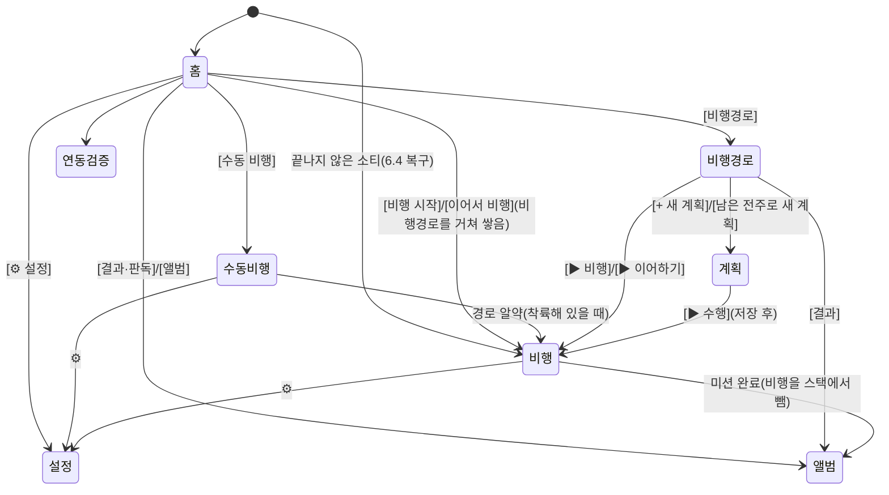

# 10.2–10.3 화면 디자인 규칙과 UI 상태머신

10.0 사용성 원칙, 10.1 시각 규칙(`06-ui-sound.md`)을 실제 수치로 정한 것이다(2026-10-30, Pilot 2 맞춤 뒤 사용자 요청). 새 화면과 고치는 화면은 이 규칙으로 검토한다. **색·크기·글꼴·화면 배치는 확정 시안 10.4(`10-ui-pilot2.md`)가 우선한다.**

## 10.2 디자인 규칙(수치)

**화면**: RC Pro는 1920×1080px, 밀도 400이라 **768×432dp**다. 앱 전체와 대화상자 모두 전체 화면(시스템 바 숨김)이다. 대화상자는 `FullscreenAlertDialog`만 쓴다(일반 `AlertDialog`는 열릴 때 바가 나타나 뒤 화면이 밀린다).

**글자**(`ui/theme/Type.kt`, Material 단계 × 0.8, 최소 11sp). 화면 코드에 `fontSize`를 직접 쓰지 않는다. 예외는 비행 화면의 큰 버튼(아래 표)뿐이다.

| 쓰임 | 스타일 |
|---|---|
| 화면 머리글 제목 | `titleMedium` 굵게 |
| 카드·목록 제목, 패널 소제목 | `titleSmall` 굵게 |
| 본문, 설정 항목 이름 | `bodyLarge`·`bodyMedium` |
| 보조 정보(수, 시각, 설명) | `labelMedium`·`bodySmall`, `onSurfaceVariant` |
| 수치 강조(배터리 %, 단계 값) | `titleSmall` 굵게 |
| 비행 화면 큰 버튼(시작·재개·착륙 확인) | `titleLarge`~`headlineSmall` 굵게 |

**크기**

| 요소 | 크기 |
|---|---|
| 머리글 줄 | 일반 화면 56dp, 비행·수동 비행 상단 바 40dp(+배터리 바 3dp), 앨범 48dp |
| 일반 버튼(보이는 높이) | **36dp**, 좌우 안쪽 12~14dp. 누르는 영역은 Material3가 48dp로 잡는다 |
| 비행 화면 주 버튼 | 비행 시작 200×56dp, 재개 220×64dp(초록), 착륙 확인 220×64dp, RTH 132×48dp(길게) |
| 지도 위 버튼·도구 | 48dp 정사각(도구 줄은 56×52dp) |
| 목록 줄 | 48dp 이상, 설정 항목 56dp, 결과 목록 56dp |
| 카드 | 모서리 10dp, 안쪽 12~14dp, 카드 사이 6dp |
| 상태 꼬리표(계획됨 등) | 모서리 4dp, 강조색 14% 바탕 |
| 미니맵 | 180×112dp, 모서리 6dp |
| 계획 오른쪽 패널 | 256dp(» 로 접음) |

**간격**: 4·6·8·12·16dp만 쓴다. 화면 가장자리는 일반 화면 16dp, 영상·지도 위 겹침은 8dp.

**색**: `MaterialTheme` 역할만 쓴다. 겹침 바탕은 지도 위 `surfaceContainer` 92%, 영상 위 검정 50%(`OverlayBg`), 상단 바 검정 60%. 데이터 색(10.1 예외)은 다음과 같다.
- 전주: 대기 주황, 완료 초록, 실패 빨강, 건너뜀 회색, 진행 파랑
- 소티 경로: 5색을 돌려 쓴다
- 이륙 지점·고른 전주 고리: 노랑 `#FFC400`
- 탐지 상자: 대상 빨강, 그 밖 노랑

**구성 요소**
- 한 화면(또는 카드 하나)에 채운 버튼(`Button`)은 하나만 둔다. 보조 동작은 `OutlinedButton`, 약한 동작(삭제·취소)은 `TextButton`에 `onSurfaceVariant`.
- 되돌릴 수 없는 동작은 대화상자로 확인하고 확인 버튼을 `error` 색으로 한다.
- 글자는 한 줄 `maxLines = 1` + 말줄임이다. 단어 중간에서 줄을 바꾸지 않는다.
- 아이콘 라이브러리는 쓰지 않고 글리프(‹ ▶ Ⅱ ⚙ ◎ ▦ ⬠ H ↶ ✕ »)를 쓴다. DJI 로고와 아이콘은 쓰지 않는다.

## 10.3 UI 상태머신

### 화면 이동

경로(`MainActivity`): `home`, `camera`(수동 비행), `projects?pid={pid}`(비행경로, pid를 주면 그 프로젝트를 고름), `map/{pid}?replan={replan}`(계획), `flight/{pid}/{mid}`, `result/{pid}/{mid}`(앨범), `settings`, `verify`.

**쌓는 규칙**
- 미션 비행은 어디서 열든(홈 [비행 시작], 수동 비행 경로 알약, 재시작 복구) `home → projects?pid=X → flight/X/Y`로 쌓는다(`openFlight`). 그래서 비행에서 뒤로 가면 그 프로젝트를 고른 비행경로, 한 번 더 가면 홈이다.
- `flight`·`settings`·`projects`는 같은 화면을 두 번 쌓지 않는다(`launchSingleTop`). 장갑으로 두 번 눌러 비행 화면(과 기체 연결)이 둘 생기지 않게 한다.
- 미션이 끝나면 `flight`를 스택에서 빼고 `result`를 연다.

**뒤로 가기**(← 버튼, Android 뒤로, RC 5D ←)는 스택을 하나 되돌린다. 다음은 예외다.

| 상황 | 동작 | 이유 |
|---|---|---|
| 대화상자가 열림 | 대화상자만 닫는다(5D ← 포함) | 5D는 SDK로 와서 뒤 화면을 닫을 수 있었다 |
| 홈에서 RC `<` | "앱을 종료할까요?" 확인 | `<`는 안드로이드 뒤로 키라 바로 꺼졌다 |
| 수동 비행 중(날고 있음) RC `<` | 무시(화면 ‹ 버튼은 됨) | 비행 중 카메라 뷰를 잃지 않게 |
| 계획에서 영역·이륙 지점을 찍는 중 | 도구만 취소한다 | 그린 영역을 잃지 않게 |
| 비행 | 실행기가 대기·소티 완료·미션 완료가 아니면 막는다 | 화면을 떠나면 실행기가 멈춘다 |
| RC 5D ← | `projects`·`settings`·`album`·`verify`에서만 뒤로 간다(허용 목록). 홈·수동 비행·비행·판독·계획은 무시하거나 다른 데 쓴다(판독은 판정 이동, 계획은 값 바꾸기) | 비행 중 잘못 눌러 RTH·착륙 확인을 잃지 않게. 새 화면은 기본으로 막힌다 |

### 화면 안 상태

| 화면 | 상태 | 겹침 |
|---|---|---|
| 비행경로 | 프로젝트 없음 / 목록. 미션: 계획됨 → 진행 중 → 완료·부분 완료 | 가져오기, 프로젝트·미션 삭제 확인, 날짜 다른 이어하기 확인 |
| 계획 | 도구: 없음 / 영역 그리기 / 이륙 지점. 단계: ① 영역 없음 → ② 이륙 없음 → 계산 중 → ③ 경로(저장 전) → 저장됨 / 경로 없음(설정 오류·전주 없음) | 고른 전주 패널, 패널 접힘 |
| 비행 | 실행기 상태(6장 `ExecState`): 대기 → 비행 전 점검 → 이륙·구간·촬영 → 일시정지(수동 비행) ⇄ 재개 → 복귀 → 소티 완료 → 미션 완료, 연결 끊김 | 비행 전 점검, 소티 완료(조종사 확인), 착륙 확인, 지도·영상 자리 바꿈 |
| 수동 비행 | 기체 없음 / 연결(착륙) / 비행 중 | 착륙 확인, 촬영 중 |
| 앨범 | 불러오는 중 / 전주 안 고름 / 사진 보기(패널 숨김 가능) | 판정 패널, 내보내기 저장 위치 |
| 설정 | 탭 8개. 기체 탭: 읽는 중 / 값 / 기체 없음(--) | 실행 확인, 모델·지도 삭제 확인 |
| 기체 점검 | 기체 없음 / 연결: 기체 종류·시리얼·펌웨어, 조종기 종류·시리얼, 비행 모드 스위치(F/N/S, 자동 비행은 N만), 확인 필요 항목을 맨 위로(2026-10-30 사용자 요청) | 보정 안내 |
| 홈 | 최근 미션 없음 / 있음(남은 전주 유무) | 기체 상태 세부 |
