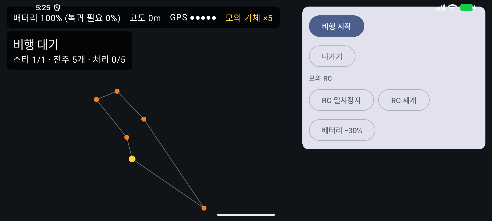
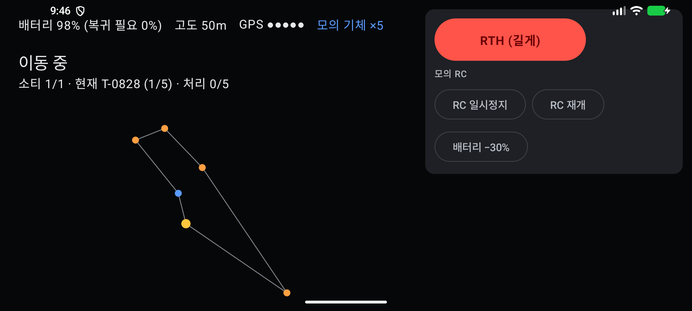
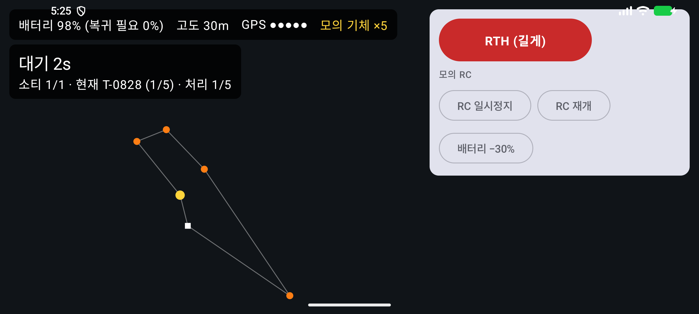
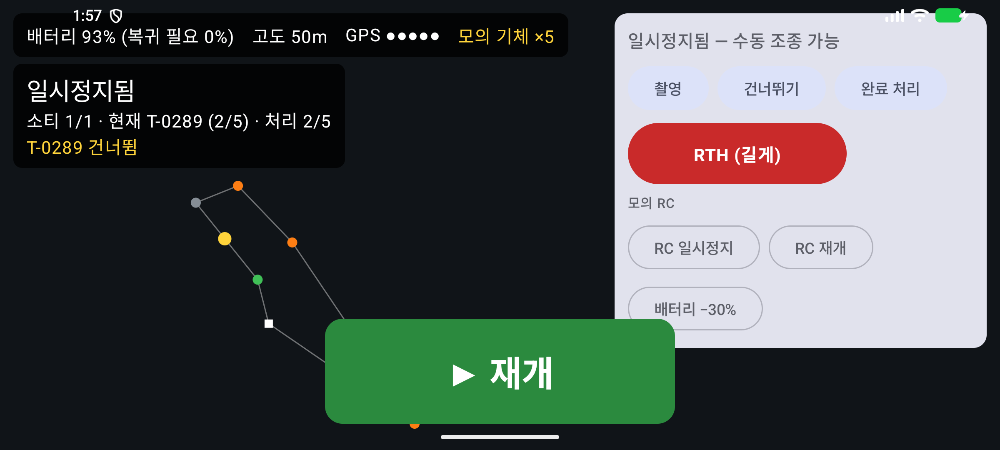
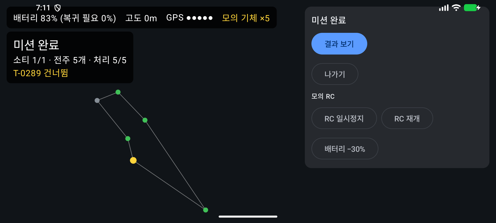

# 증빙: 비행 화면 ④ — 모의 기체로 저장한 계획 실행 (2026-09-29)

- 대상: 커밋 `04cd147` 위의 변경
  - `ui/FlightScreen.kt`: 비행 화면, 신호음 알림
  - `data/RoomRecorder.kt`: 실행 기록을 Room에 저장
  - `CAPTURE`, `DETECTION`, `FLIGHT_EVENT` 엔티티
  - 계획 화면의 [비행 시작]
- 기체: `FakeDroneGateway`(모의 시간 ×5). 실제 기체와 DJI SDK는 쓰지 않았다.
- 환경: macOS(Apple Silicon), 에뮬레이터 `Pixel_8`(arm64, 2400×1080 가로), Android Studio JBR

## 1. 자동 테스트

| 종류 | 명령 | 결과 | 보고서 |
|------|------|------|--------|
| `:core` 단위 | `./gradlew :core:test --rerun-tasks` | 40개 통과, 실패 0 | [reports/core-unit/index.html](reports/core-unit/index.html) |
| `:app` 계측 | `./gradlew connectedDebugAndroidTest` | 5개 통과, 실패 0 | [reports/app-instrumented/index.html](reports/app-instrumented/index.html) |

새 계측 테스트는 비행 파라미터 JSON을 저장했다가 다시 읽으면 같은 값이 나오는지 확인한다. 상태머신 자체는 `:core`의 `InspectionExecutorTest` 18개가 이미 검증한다.

## 2. 화면 스모크 시험

다시 실행하려면 에뮬레이터를 켜고 `./gradlew installDebug`를 실행한 뒤 `bash docs/evidence/2026-09-29-flight/smoke.sh`를 실행한다. 한 번에 약 2분 걸린다.

스크립트는 작은 영역(전주 5개)으로 계획을 저장하고 [비행 시작]을 누른다. 이후에는 화면 문구를 기다리며 진행한다.

| 단계 | 확인한 것 | 화면 |
|------|-----------|------|
| 1. 비행 화면 | "모의 기체 ×5", "비행 대기". 가운데에는 FPV 대신 위에서 본 그림(이륙 지점, 경로, 전주, 기체)이 나온다 |  |
| 2. 비행 시작 | 비행 전 점검 → 이륙 → "이동 중". 자동 비행 중 버튼은 [RTH (길게)]뿐이다 |  |
| 3. 첫 전주 | 도착 → 광각·망원 촬영 → 다운로드 → 분석 건너뜀(탐지 모델 없음) → "대기 2s" 카운트다운 |  |
| 4. RC 일시정지 | 두 번째 구간 비행 중 [RC 일시정지](하드웨어 버튼 대신)를 누른다. "일시정지됨 — 수동 조종 가능", 큰 초록 [▶ 재개], [촬영] [건너뛰기] [완료 처리]가 나온다. [건너뛰기]를 누르면 "T-0289 건너뜀"이 나온다 |  |
| 5. 재개부터 미션 완료까지 | [▶ 재개]를 누르면 다음 미점검 전주로 간다. 나머지 3개를 점검하고 자동 복귀·착륙하면 "미션 완료"가 나온다. 전주는 완료=초록, 건너뜀=회색이다 |  |

## 3. DB·이미지·알림음 대조

스크립트는 비행이 끝난 뒤 세 가지를 꺼내 대조한다.

- 앱 DB(`run-as`)
- 이미지 폴더 목록(`projects/1/missions/1/images/`)
- 알림음 로그([sound.log](sound.log))

[verify.py](verify.py)의 21개 항목이 모두 일치했다.

```
일치: 미션 상태 기대 DONE, 앱 DONE
일치: 건너뛴 전주 1개(운용자 건너뛰기) …
일치: 나머지 전주는 모두 완료 기대 4, 앱 4
일치: 완료 전주는 도착 시각이 있음 기대 True, 앱 True
일치: 사진 = 완료 전주 × 렌즈 2개(광각, 망원) …
일치: 사진 출처는 모두 AUTO / 미리보기라 원본 아님
일치: 이미지 파일 = DB 사진(4.3 이름 규칙 <전주번호>_<시각>_<렌즈>.jpg) — 8장
일치: DB 파일 경로 = 이미지 파일
일치: 소티 완료, 시작 ≤ 종료
일치: 상태 기록이 끊김 없이 이어짐 (36건, Idle→PreflightCheck … →MissionDone)
일치: RC 일시정지 기록 1, 재개 기록 1
일치: 도착음 = 완료 전주 수 4, 일시정지음 1, 재개음 1
일치: 모의 탐지기 모델 버전 fake-1
일치: 이상음 = 이상 탐지 전주 수, 점검 완료음 = 나머지 완료 전주 (1, 3)
일치: 분석 오류음 없음 0
일치: 모의 탐지: 사진 5장마다 1장 [5]
전주 5개, 상태 전이 36건, 사진 8장
```

## 4. 알려진 한계

- 기체는 모의 기체다. 영상(FPV), 실제 RC 버튼, LDM은 PoC 뒤 `DjiDroneGateway`에서 붙인다.
- 탐지 모델이 없어 처음에는 전주마다 "분석 건너뜀" 경고음이 났다(6.5 규칙). 결과 화면 ⑤를 붙이면서 모의 탐지기(`FakeDetector`)를 넣어, 이제 이상 전주는 이상음, 나머지는 점검 완료음이 난다. 사진도 텍스트 대신 640×480 JPEG이다([결과 증빙](../2026-09-29-result/README.md)).
- 알림은 음성 대신 `ToneGenerator` 신호음이다. 녹음 파일이 준비되면 `SoundPool`로 바꾼다(11장).
- 비행 중에 화면을 떠나면 실행기가 멈춘다. 그래서 비행 중에는 뒤로 가기를 막았다. 앱 재시작 복구(6.4)는 아직 없다. 다시 열면 남은 전주만 처음 상태로 다시 비행한다.
- [다시 계획] 버튼과 모의 연결 끊김·장애물 회피 조작은 아직 없다. 이 상황들은 `:core` 단위 테스트가 검증한다.
