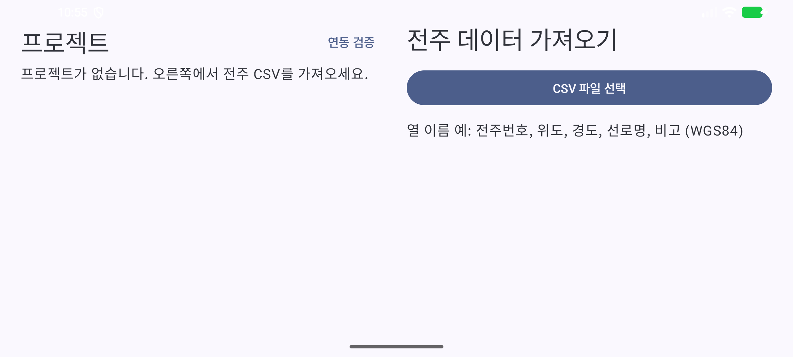
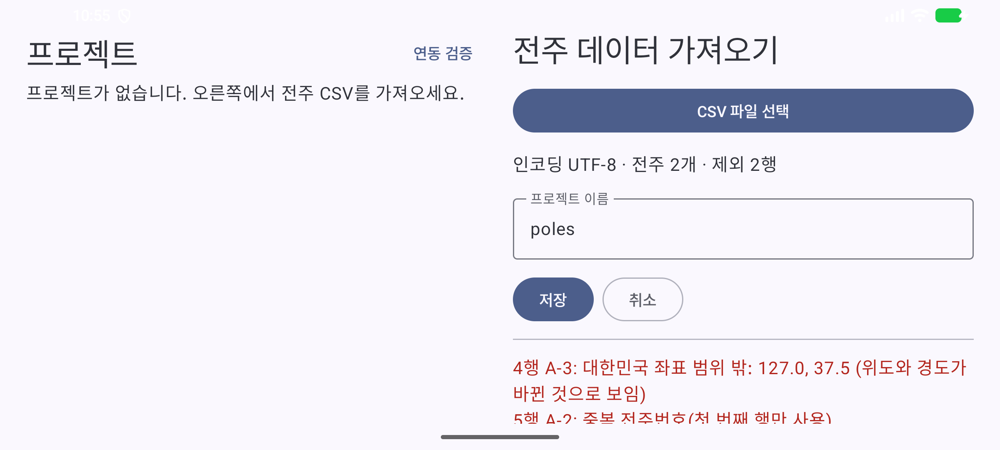
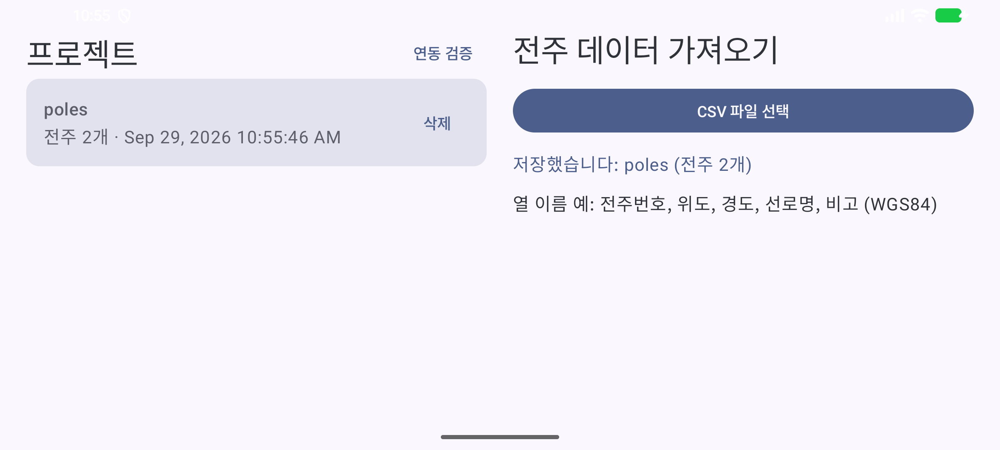
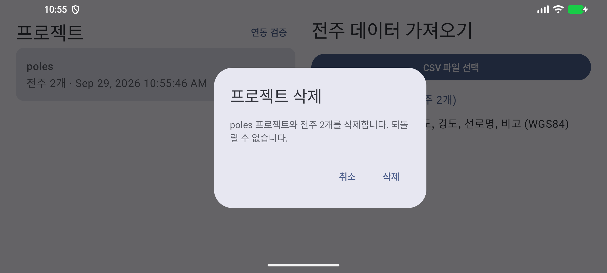
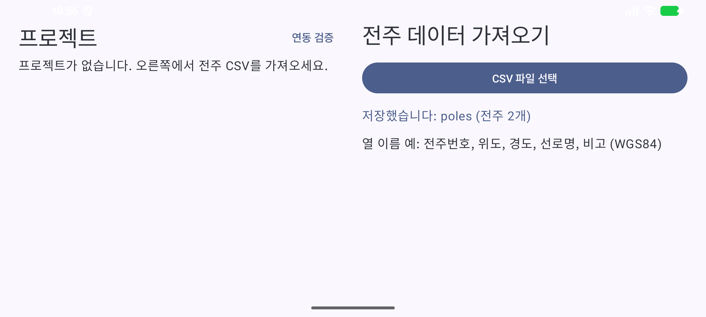

# 증빙: 가져오기 화면과 Room (2026-09-29)

- 대상: 커밋 `589011b` 위의 미커밋 변경(Room `PROJECT`/`POLE`, `ui/ProjectScreen.kt`)
- 환경: macOS(Apple Silicon), 에뮬레이터 `Pixel_8`(arm64), Android Studio JBR

## 1. 자동 테스트

| 종류 | 명령 | 결과 | 보고서 |
|------|------|------|--------|
| `:core` 단위 | `./gradlew :core:test --rerun-tasks` | 39개 통과, 실패 0 | [reports/core-unit/index.html](reports/core-unit/index.html) |
| `:app` 계측 | `./gradlew connectedDebugAndroidTest` | 3개 통과, 실패 0 (`ProjectDaoTest` 2개 + 템플릿 1개) | [reports/app-instrumented/index.html](reports/app-instrumented/index.html) |

`:core` 내역: `PoleCsvParserTest` 7, `InspectionExecutorTest` 18, `RoutePlannerTest` 5, `TspSolverTest` 4, `GeoTest` 3, `FlightParamsTest` 2.

## 2. 화면 스모크 시험

입력 파일 [poles.csv](poles.csv)는 5행이다. A-1과 A-2는 정상 행이고, A-3은 위도와 경도가 바뀌었고, 마지막 A-2는 전주번호가 중복된다.

다시 실행하는 방법: 에뮬레이터를 켜고 `./gradlew installDebug`를 실행한 뒤 `docs/evidence/2026-09-29-import-screen/smoke.sh`를 실행한다. 스크립트는 화면 문구를 `uiautomator`로 확인하고, 문구가 없으면 실패로 끝난다.

| 단계 | 확인한 문구 | 화면 |
|------|-------------|------|
| 1. 첫 실행 | "프로젝트가 없습니다" |  |
| 2. CSV 선택 | "전주 2개 · 제외 2행", "위도와 경도가 바뀐 것으로 보임", "중복 전주번호" |  |
| 3. 저장 | "저장했습니다: poles (전주 2개)", 카드 "전주 2개" |  |
| 4. 삭제 확인 창 | "poles 프로젝트와 전주 2개를 삭제합니다" |  |
| 5. 삭제 후 | "프로젝트가 없습니다" |  |

에뮬레이터에서는 "16 KB 페이지 호환 아님" 경고 창이 뜬다. 원인은 DJI SDK의 네이티브 라이브러리이고, 스크립트가 이 창을 닫는다.
