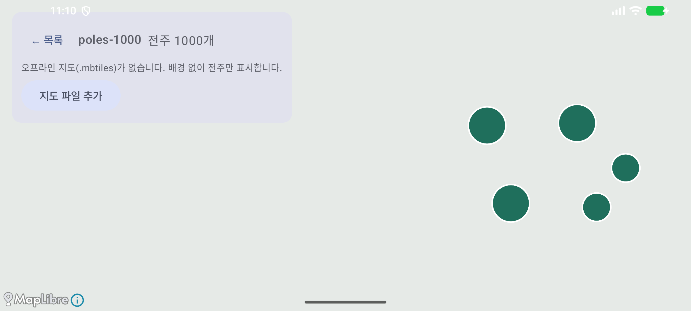
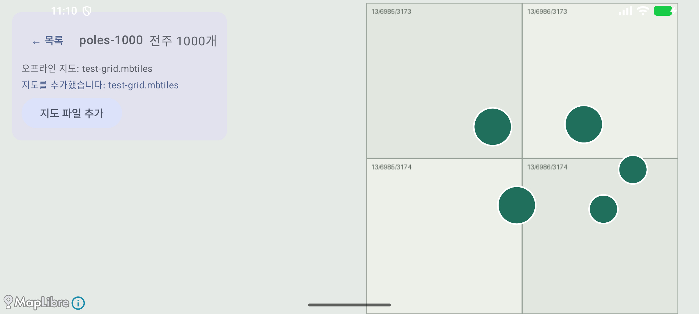
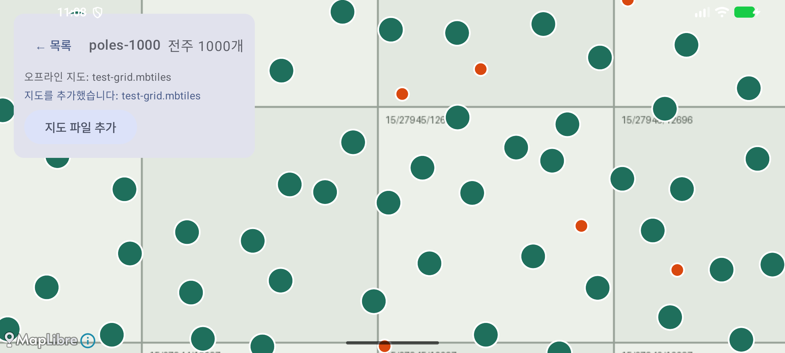
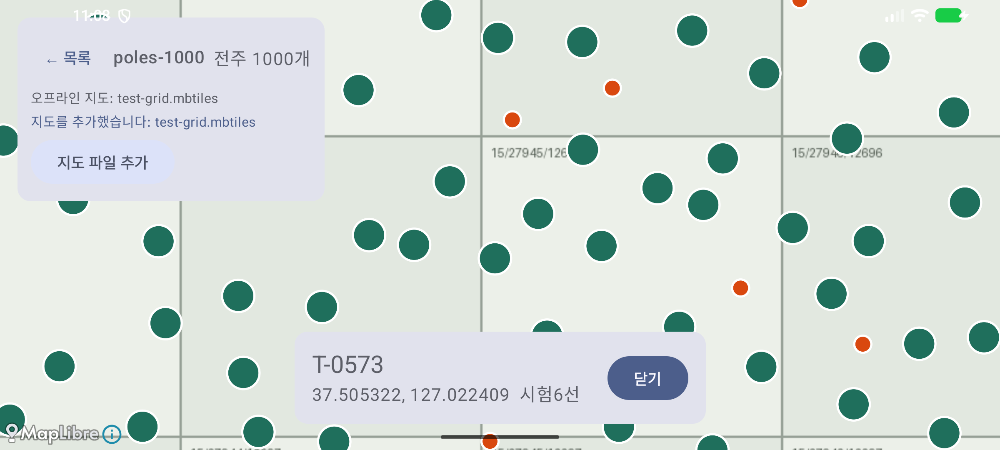
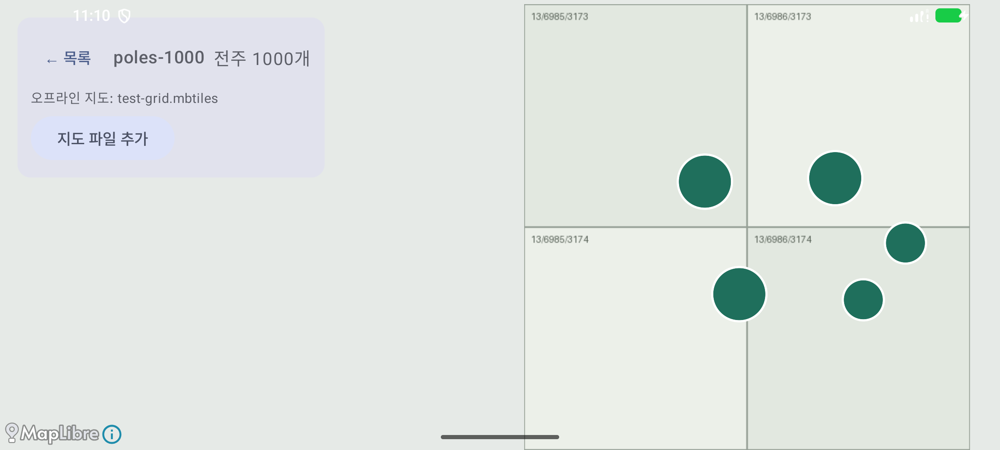

# 증빙: MapLibre 오프라인 지도 (2026-09-29)

- 대상: 브랜치 `feat/room-import-screen`의 미커밋 변경(`ui/MapScreen.kt`, MapLibre 13.6.1 `android-sdk-opengl`)
- 환경: macOS(Apple Silicon), 에뮬레이터 `Pixel_8`(arm64), Android Studio JBR
- 시험 데이터: `python3 tools/make_test_data.py <폴더> 1000`로 만든 전주 1,000개 CSV와 합성 격자 MBTiles(타일 167개, 줌 11–16). 타일에는 `z/x/y` 번호가 적혀 있다. 실제 지도(VWorld)는 약관 확인 전이라 쓰지 않았다.

## 1. 자동 테스트

| 종류 | 명령 | 결과 |
|------|------|------|
| `:core` 단위 | `./gradlew :core:test --rerun-tasks` | 39개 통과, 실패 0 |
| `:app` 계측 | `./gradlew connectedDebugAndroidTest` | 3개 통과, 실패 0 |

HTML 보고서는 `reports/`에 있다(git 제외).

## 2. 화면 스모크 시험

다시 실행: 에뮬레이터를 켜고 `./gradlew installDebug`를 실행한 뒤 `docs/evidence/2026-09-29-map/smoke.sh`를 실행한다. 1, 2, 5번 화면은 스크립트가 만든다. 3, 4번 화면은 지도 위 좌표가 데이터마다 달라서 손으로 눌러 찍었다(카메라 여백을 고치기 전 화면).

| 단계 | 확인한 것 | 화면 |
|------|-----------|------|
| 1. 지도 열기(배경 없음) | "전주 1000개", "오프라인 지도(.mbtiles)가 없습니다", 클러스터 원 |  |
| 2. MBTiles 추가 | "지도를 추가했습니다: test-grid.mbtiles", 격자 타일 표시 |  |
| 3. 클러스터 누르기(수동) | 2단계 확대, 개별 전주(주황)가 나타남 |  |
| 4. 전주 누르기(수동) | 카드 "T-0573 37.505322, 127.022409 시험6선". CSV 574행과 일치 |  |
| 5. 네트워크 끄고 재시작 | Wi-Fi·데이터를 끄고 앱을 강제 종료한 뒤 다시 열어도 타일과 전주가 표시됨 |  |

## 3. 알려진 한계

- 지도 위 글자(클러스터 개수, 전주번호)는 그리지 않는다. 오프라인 글리프(폰트) 파일이 없기 때문이다. 전주번호는 전주를 누르면 카드로 보여 준다.
- VWorld 타일 내려받기(F-04)는 약관 확인 전까지 보류한다. 그동안 MBTiles 파일을 [지도 파일 추가]로 넣는다.
