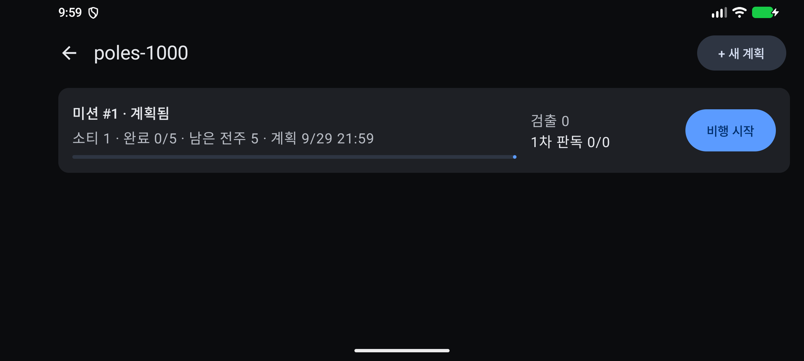
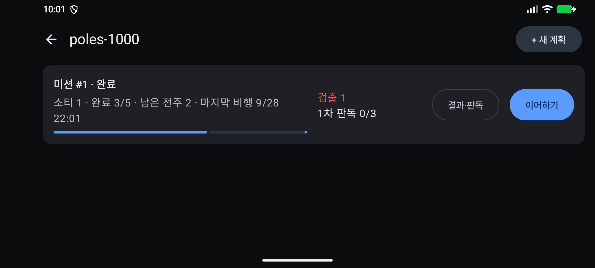
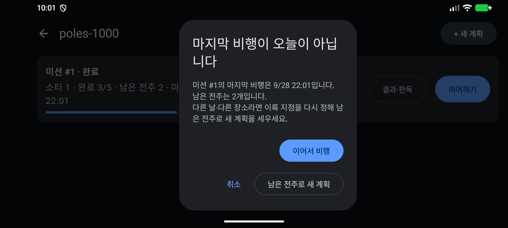
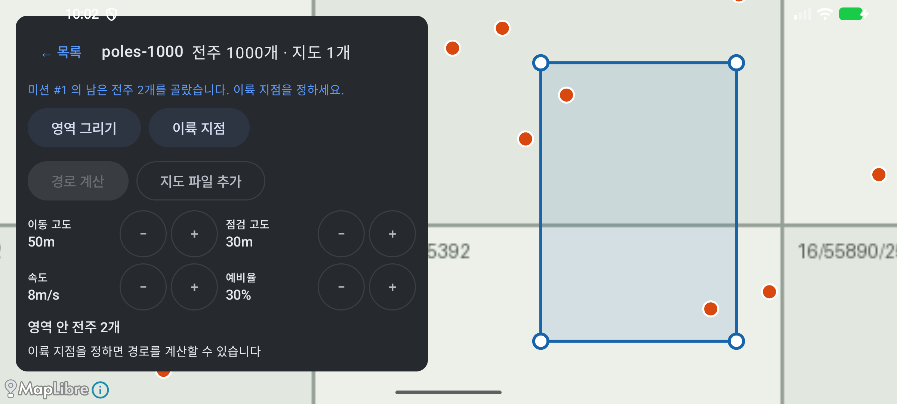
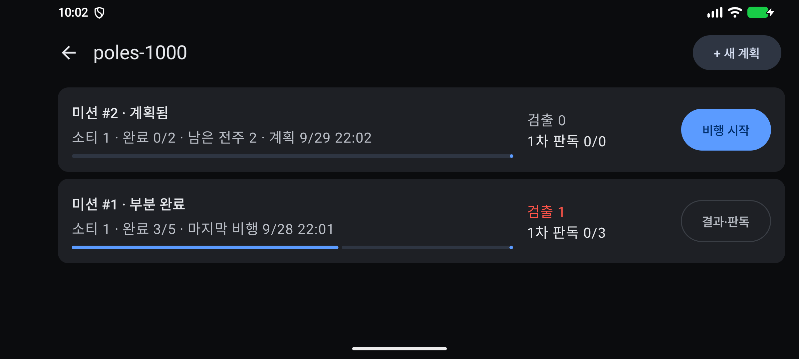

# 증빙: 미션 목록(①-1)과 이어하기(F-20) (2026-09-29)

- 대상
  - `ui/mission/MissionListViewModel.kt`, `ui/mission/MissionListScreen.kt`
    - 프로젝트를 누르면 미션 목록이 열린다.
    - 미션 카드에는 상태, 소티 수, 완료/전체, 남은 전주, 마지막 비행 시각, 검출 수, 1차 판독 수가 나온다.
    - 버튼: [비행 시작](계획됨), [이어하기](남은 전주 있음), [결과·판독]
    - 목록은 Room Flow라 비행이나 판독을 하고 돌아오면 저절로 바뀐다.
  - `ProjectDao.observeMissions`: 미션 카드 한 장을 쿼리 하나로 센다.
  - `:core` `needsResumeConfirm`: 마지막 비행의 현지 날짜가 오늘이 아니면 묻는다. 단위 테스트가 있다(자정을 넘긴 경우 포함).
  - 날짜 확인 대화상자(MD3 `AlertDialog`): [이어서 비행] / [남은 전주로 새 계획] / [취소]
  - `MapScreen(replanFrom)`
    - 남은 전주를 감싸는 사각형을 영역으로 두고, 그 안의 다른 전주는 제외한 상태로 연다.
    - 저장하면 기존 미션을 `PARTIAL`(부분 완료)로 닫는다.
  - 프로젝트 카드의 [결과] 버튼은 없앴다. 결과는 미션 목록에서 연다.
- 기체: `FakeDroneGateway`(모의 시간 ×5), 모의 탐지기
- 환경: 에뮬레이터 `Pixel_8`(arm64, 2400×1080 가로)

## 다시 돌리기

```bash
./gradlew installDebug
bash docs/evidence/2026-09-29-missions/smoke.sh    # 약 5분
```

## 시나리오와 결과

| 단계 | 확인한 것 | 화면 |
|------|-----------|------|
| 1. 계획 저장 뒤 | 계획 화면의 [← 목록]으로 돌아가면 "미션 #1 · 계획됨"과 [비행 시작]이 있다 |  |
| 2. 일부만 비행 | 3개 점검 → RTH(길게) → 소티 완료 → [미션 종료] → [나가기]. 목록에 "완료 3/5 · 남은 전주 2"와 [이어하기]가 있다 |  |
| 3. 같은 날 이어하기 | 날짜 확인 없이 바로 비행 화면("전주 2개")이 열린다 | — |
| 4. 어제 비행한 미션 | 앱을 멈추고 DB의 소티 시각을 하루 앞당긴 뒤 다시 연다. 카드에 "마지막 비행 9/28 …"이 나온다 |  |
| 5. 날짜 확인 | [이어하기]를 누르면 "마지막 비행이 오늘이 아닙니다 … 남은 전주는 2개입니다"가 나온다. [이어서 비행]은 같은 미션의 비행 화면을 연다 |  |
| 6. 남은 전주로 새 계획 | 계획 화면이 "미션 #1 의 남은 전주 2개를 골랐습니다"로 열린다. 이륙 지점 → 경로 계산 → 저장하면 "미션 #2 (소티 1개, 전주 2개)"가 된다 |  |
| 7. 목록 | "미션 #2 · 계획됨", "미션 #1 · 부분 완료" |  |

DB 대조 결과([verify.txt](verify.txt))는 5개 항목이 모두 일치했다.

- 미션 #1은 `PARTIAL`, #2는 `PLANNED`
- 미션 #1은 3개 완료, 2개 남음
- 미션 #2의 전주는 미션 #1의 남은 전주(T-0711, T-0949)와 같고, 모두 대기 상태다.
- 미션 #1의 마지막 비행은 어제 날짜다.

## 알려진 한계

- "어제 비행"은 DB 시각을 바꿔 흉내 냈다. 에뮬레이터 시계는 바꾸지 않았다.
- [남은 전주로 새 계획]의 영역은 남은 전주를 감싸는 사각형(가장자리 약 30m)이다. 운용자가 영역을 다시 그리면 이 선택은 사라진다.
- 계획 화면(`MapScreen`)과 프로젝트 화면은 아직 `ViewModel`로 옮기지 않았다(Android 개발 규칙 미적용, CLAUDE.md 알려진 이슈).
- 이륙 지점이 계획과 먼지 확인하는 부분(5.4)은 기체 연동 뒤에 붙인다.

## 전체 회귀 (2026-09-29, 이 커밋)

| 종류 | 결과 |
|------|------|
| `:core` 단위 | 45개 통과 ([reports/core-unit](reports/core-unit/index.html)) |
| `:app` 계측 | 6개 통과 ([reports/app-instrumented](reports/app-instrumented/index.html)) |
| 스모크 9개 | 가져오기, 지도, 계획, 계획 저장, 비행, 결과, 탐지, 소티, 미션 모두 통과 |

- 프로젝트를 누르면 미션 목록이 열리도록 바뀌었다. 그래서 예전 스모크 스크립트(가져오기 제외)에 [+ 새 계획]을 누르는 단계를 더했다.
- 예전 증빙 폴더(가져오기·지도·계획·계획 저장)의 스크린샷은 당시 것을 그대로 두었다.
- 가져오기 스모크는 `adb push`가 파일 수정 시각을 유지해 파일 선택기에 CSV가 안 보이는 문제가 있었다. 넣은 뒤 `touch`하도록 고쳤다.
