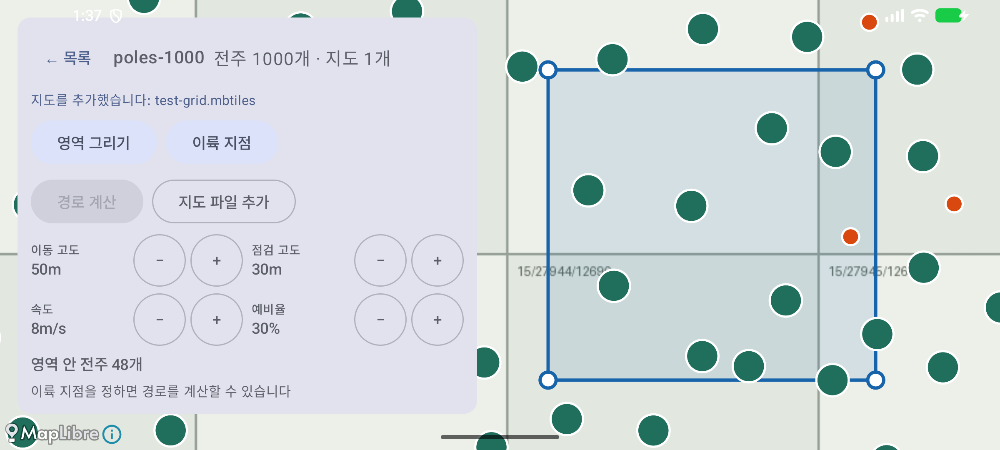
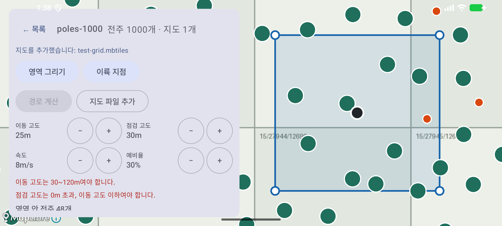
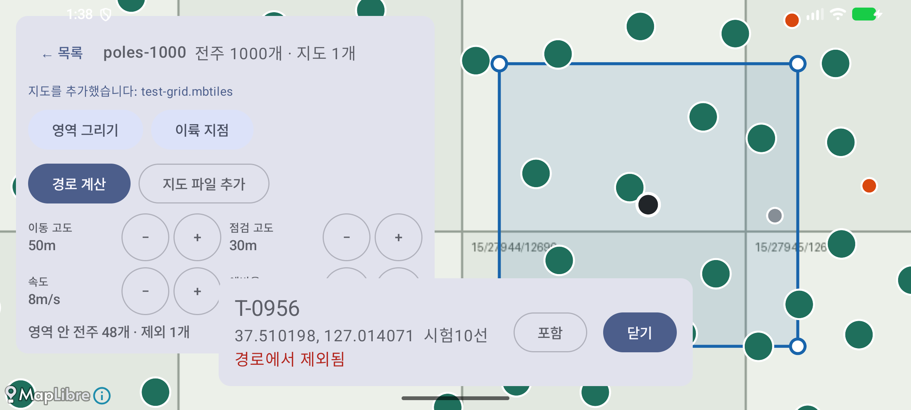
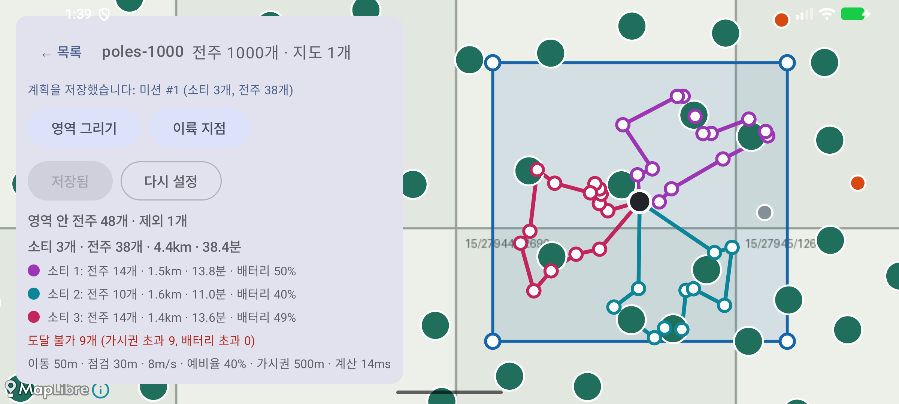

# 증빙: 계획 화면 — 파라미터, 전주 제외, 계획 저장 (2026-09-29)

- 대상: 커밋 `5b39a9a` 위의 변경
  - 핵심 파라미터 4개 [−][+] UI(6.3)
  - 전주 개별 포함/제외(F-06)
  - 계획 저장(`MISSION`, `SORTIE`, `VISIT`)
  - 소티별 경로 재최적화(5.4)와 경로 방문점 표시
- 환경: macOS(Apple Silicon), 에뮬레이터 `Pixel_8`(arm64, 2400×1080 가로), Android Studio JBR
- 시험 데이터: `tools/make_test_data.py`의 전주 1,000개(seed 42)와 합성 격자 지도. 영역과 이륙 지점은 [이전 증빙](../2026-09-29-plan/README.md)과 같다.

## 1. 자동 테스트

| 종류 | 명령 | 결과 | 보고서 |
|------|------|------|--------|
| `:core` 단위 | `./gradlew :core:test --rerun-tasks` | 40개 통과, 실패 0 | [reports/core-unit/index.html](reports/core-unit/index.html) |
| `:app` 계측 | `./gradlew connectedDebugAndroidTest` | 4개 통과, 실패 0 | [reports/app-instrumented/index.html](reports/app-instrumented/index.html) |

새로 추가한 테스트는 두 개다.

- `RoutePlannerTest` "소티마다 다시 최적화해 경로가 스스로 교차하지 않는다": 전주 150개로 계획한 뒤, 소티마다 경로 구간끼리 교차하지 않는지 확인한다. 재최적화를 끄면 이 테스트가 실패하는 것을 확인했다.
- `ProjectDaoTest` "계획_저장은_소티와_방문_순서를_남기고_프로젝트와_함께_지워진다": 소티 번호, 방문 순서, 프로젝트를 삭제할 때 하위 행이 함께 지워지는지 확인한다.

## 2. 화면 스모크 시험

다시 실행하려면 에뮬레이터를 켜고 `./gradlew installDebug`를 실행한 뒤 `bash docs/evidence/2026-09-29-plan-save/smoke.sh`를 실행한다.

제외할 전주는 스크린샷에서 주황 점을 찾아 고른다([find_pole.py](find_pole.py)). 영역 가운데에 가장 가까운 점을 누른다.

| 단계 | 확인한 것 | 화면 |
|------|-----------|------|
| 1. 영역 완료 | 파라미터 기본값(이동 50m, 점검 30m, 8m/s, 예비율 30%), "영역 안 전주 48개" |  |
| 2. 범위 검사 | 이동 고도를 25m로 내리면 "이동 고도는 30~120m여야 합니다." 문구가 나오고 [경로 계산]이 비활성이 된다. 50m로 되돌리고 예비율은 40%로 올린다 |  |
| 3. 전주 제외 | 전주 카드에 "경로에서 제외됨"이 나오고, 패널에 "영역 안 전주 48개 · 제외 1개"가 나온다. 지도에는 회색 점으로 표시된다 |  |
| 4. 계산과 저장 | 소티 3개(14·10·14개)가 나오고, "계획을 저장했습니다: 미션 #1"과 [저장됨]이 표시된다. 경로가 꺾이는 곳마다 방문 전주 점이 찍힌다 |  |

## 3. 계산 결과와 DB 대조

스크립트는 두 가지를 앱 밖에서 다시 계산해 대조한다.

- logcat([routeplan.log](routeplan.log)): 영역 판정, 제외 반영, 가시권 판정을 CSV로 다시 계산한다.
- 앱 DB(`inspection.db`): `run-as`로 꺼내 저장 내용을 확인한다.

[verify.py](verify.py)의 대조 항목 15개가 모두 일치했다.

```
일치: 영역 안 전주 기대 48, 앱 48
일치: 제외 전주 수 기대 1, 앱 1
일치: 제외 전주가 영역 안에 있음 기대 True, 앱 True
일치: 가시권 초과(제외 전주 뺀 뒤) 기대 9, 앱 9
일치: 방문 + 도달 불가 = 영역 안 − 제외 기대 47, 앱 47
일치: 로그 파라미터(이동, 점검, 속도, 예비율) 기대 [50.0, 30.0, 8.0, 40.0], 앱 [50.0, 30.0, 8.0, 40.0]
일치: DB 미션 수 기대 1, 앱 1
일치: DB 미션 번호 = 로그 기대 1, 앱 1
일치: DB 상태 기대 PLANNED, 앱 PLANNED
일치: DB 이륙 지점 = 로그 …
일치: DB 파라미터 = 로그 기대 [50.0, 30.0, 8.0, 40.0], 앱 [50, 30, 8, 40]
일치: DB 영역 꼭짓점 = 로그(닫힌 고리, 1e-6° 이내) 기대 True, 앱 True
일치: DB 소티별 방문 수 = 로그 기대 [14, 10, 14], 앱 [14, 10, 14]
일치: DB 방문 전주 중복 없음 기대 38, 앱 38
일치: DB 방문 전주는 영역 안, 제외 전주 아님 기대 True, 앱 True
제외 전주 ['T-0956'], 계산 시간 14ms
```

영역 좌표는 MapLibre GeoJSON이 소수 7자리(약 1cm)로 반올림해 저장한다. 그래서 오차 1e-6°(약 10cm)까지는 같은 점으로 비교한다.

## 4. "경로가 구불구불하다"는 지적에 대한 조치

원인은 두 가지였다.

- **줌 15에서는 전주가 클러스터(초록 원)에 가려 보이지 않는다.** 그래서 선이 이유 없이 꺾이는 것처럼 보였다. 실제로 꺾이는 점은 모두 전주다. 이제 방문 전주를 소티 색 테두리의 흰 점으로 클러스터 위에 그린다.
- **소티를 전체 순회 경로에서 잘라내기만 했다.** 잘라낸 구간은 귀환 구간을 고려하지 않아, 경로가 꼬이거나 되돌아가는 모양이 남았다. 이제 분할한 뒤 소티마다 TSP를 다시 풀고, 더 짧을 때만 순서를 바꾼다(설계서 5.4에 추가).

같은 입력(제외 1개, 예비율 40%)에서 총거리가 4.6km에서 4.4km로 줄었다.

## 5. 알려진 한계

- 파라미터 기본값을 저장하지 않는다(DataStore는 ⑥ 설정 화면에서 붙인다). "고급" 패널(가시권 반경 등)도 아직 없다.
- 저장한 계획을 다시 불러오는 화면은 없다. ④ 비행 화면(4단계)이 `MISSION`을 읽는다.
- 전주 제외는 줌을 키워 개별 점이 보여야 할 수 있다. 줌 15 이하에서는 클러스터가 개별 전주를 가린다.
- 경로를 보는 동안에는 파라미터 대신 경로 요약을 보여 준다. 가로 1080px 화면에 모두 들어가게 하려는 것이다. 파라미터를 바꾸려면 [다시 설정]을 누른다.
