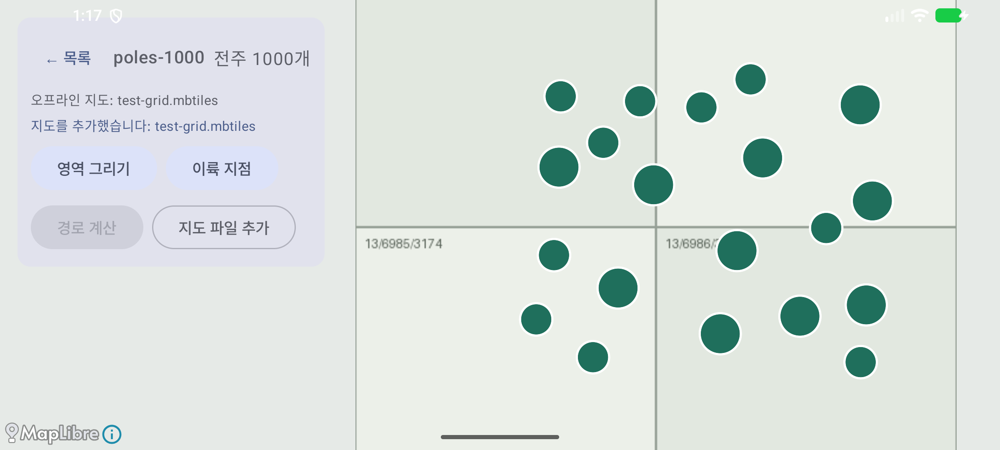
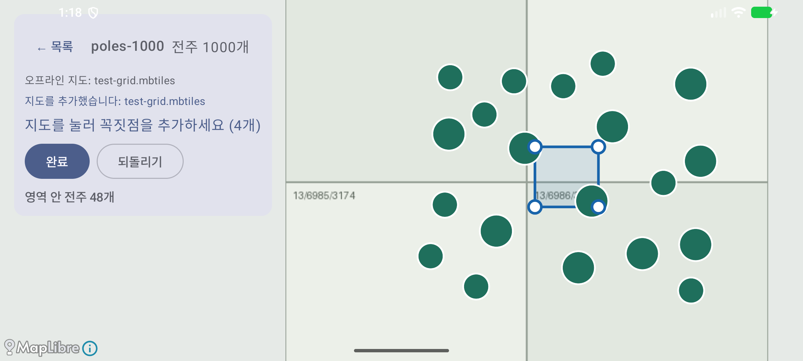
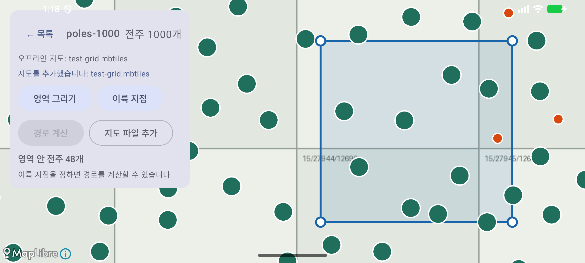
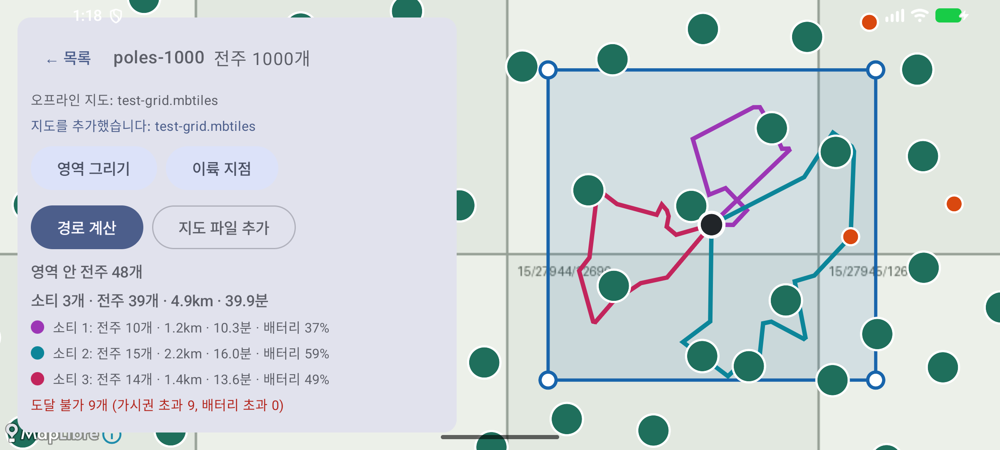

# 증빙: 계획 화면 — 영역 그리기와 경로 미리보기 (2026-09-29)

- 대상: 커밋 `4224174` 위의 변경(`ui/MapScreen.kt` 계획 기능, 매니페스트 가로 고정)
- 환경: macOS(Apple Silicon), 에뮬레이터 `Pixel_8`(arm64, 2400×1080 가로), Android Studio JBR
- 시험 데이터: `tools/make_test_data.py`의 전주 1,000개(seed 42)와 합성 격자 지도

## 1. 자동 테스트

| 종류 | 명령 | 결과 | 보고서 |
|------|------|------|--------|
| `:core` 단위 | `./gradlew :core:test --rerun-tasks` | 39개 통과, 실패 0 | [reports/core-unit/index.html](reports/core-unit/index.html) |
| `:app` 계측 | `./gradlew connectedDebugAndroidTest` | 3개 통과, 실패 0 | [reports/app-instrumented/index.html](reports/app-instrumented/index.html) |

## 2. 화면 스모크 시험

다시 실행하려면 에뮬레이터를 켜고 `./gradlew installDebug`를 실행한 뒤 `bash docs/evidence/2026-09-29-plan/smoke.sh`를 실행한다. 스크립트는 지도의 화면 좌표를 직접 누르므로, 같은 에뮬레이터와 같은 시험 데이터에서만 결과가 같다.

| 단계 | 확인한 것 | 화면 |
|------|-----------|------|
| 1. 지도 열기 | [경로 계산] 버튼(비활성) |  |
| 2. 영역 그리기 | 꼭짓점 5개를 찍고 [되돌리기]를 누르면 "(5개)"가 "(4개)"로 바뀐다 |  |
| 3. 완료 | "영역 안 전주 48개", "이륙 지점을 정하면…". 지도가 영역으로 확대된다 |  |
| 4. 이륙 지점과 경로 계산 | 소티 3개(10·15·14개), 도달 불가 9개(가시권 500m 초과) |  |

## 3. 계산 결과 대조

앱은 경로를 계산할 때 꼭짓점, 이륙 지점, 결과를 logcat(`RoutePlan`)에 남긴다([routeplan.log](routeplan.log)). [verify.py](verify.py)는 이 꼭짓점과 이륙 지점으로 CSV를 다시 계산한다. 앱 코드를 쓰지 않고 같은 공식(ray casting, 등거리 근사)을 따로 구현했다.

```
일치: 영역 안 전주 기대 48, 앱 48
일치: 가시권 초과 기대 9, 앱 9
일치: 방문 + 도달 불가 = 영역 안 기대 48, 앱 48
계산 시간 20ms (N-04 기준 300개 3초)
```

## 4. 알려진 한계

- 파라미터는 기본값(이동 고도 50m, 8m/s, 예비율 30%, 가시권 500m)으로 계산한다. 핵심 4개 설정 UI는 아직 없다.
- 전주 개별 포함/제외(F-06), 사각형 전용 도구, 계획 저장(`MISSION`)은 아직 없다.
- 도달 불가 전주는 개수만 보여 주고 지도에는 따로 표시하지 않는다.
- 줌 15 이하에서는 클러스터가 개별 전주를 가려서, 경로가 꺾이는 점이 보이지 않을 수 있다.
- 에뮬레이터에서는 "16 KB 페이지 호환 아님" 경고 창이 뜬다(DJI 네이티브 라이브러리). 스크립트가 이 창을 닫는다.
