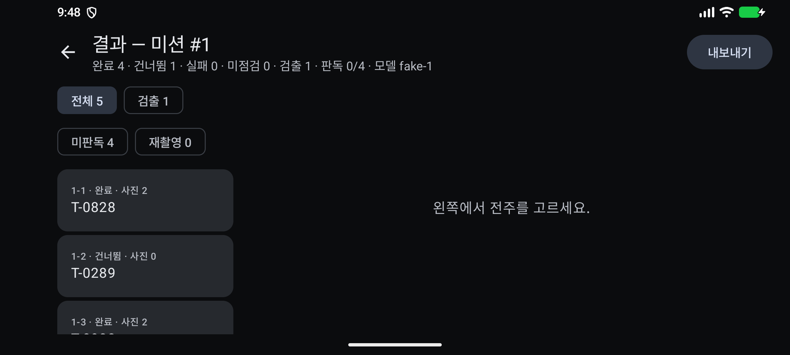
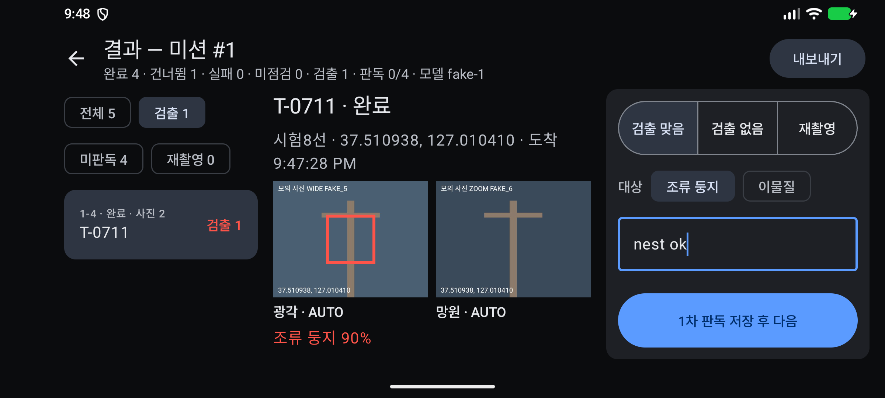
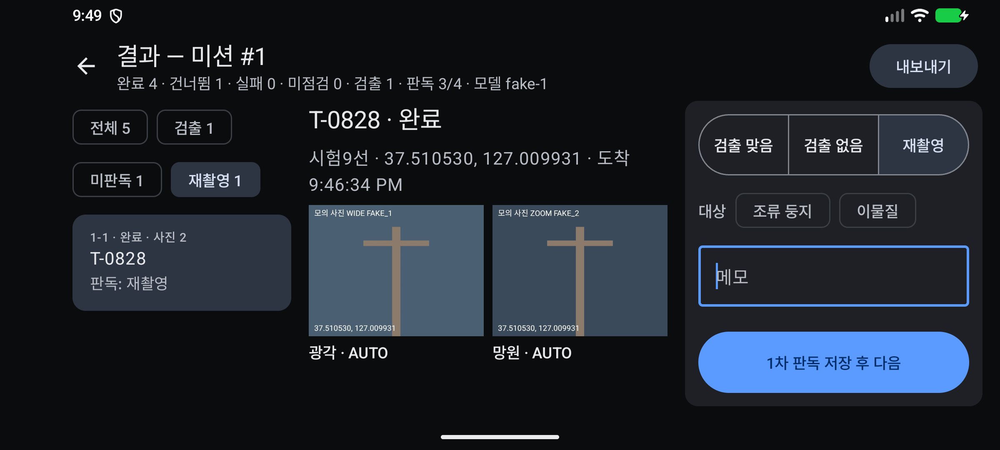
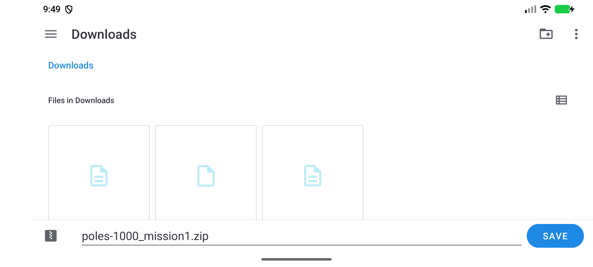
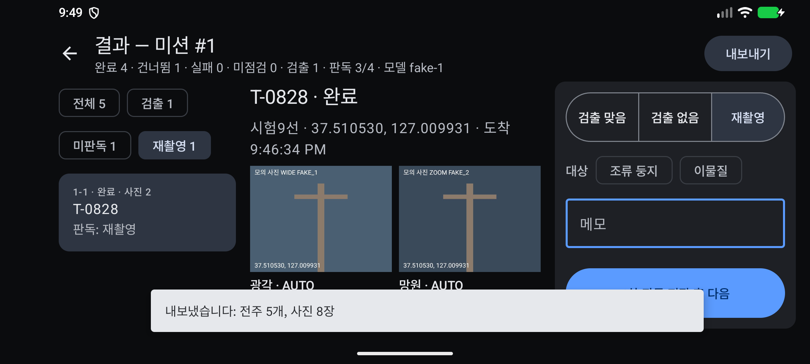
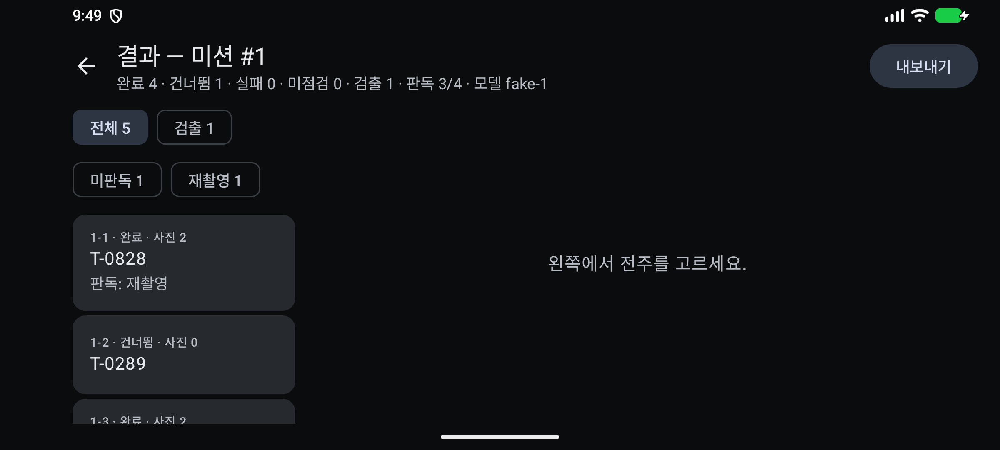

# 증빙: 결과 화면 ⑤, 1차 판독(F-19)과 내보내기 (2026-09-29)

- 대상
  - `ui/result/ResultViewModel.kt`, `ui/result/ResultScreen.kt`
    - Android 개발 규칙(MVVM, `StateFlow` 단방향 흐름)에 맞춰 화면 로직을 `ViewModel`로 옮겼다.
    - 화면은 MD3 컴포넌트(`TopAppBar`, `FilterChip`, `ListItem`, `SingleChoiceSegmentedButtonRow`, `Snackbar`)로 다시 만들었다.
  - 필터: [전체] [검출] [미판독] [재촬영]
  - 1차 판독 패널
    - 판정: 검출 맞음 / 검출 없음 / 재촬영
    - 대상 칩(조류 둥지, 이물질). AI가 검출한 대상은 미리 켜진다.
    - 메모와 [1차 판독 저장 후 다음]
  - `REVIEW` 테이블: 판정할 때마다 한 줄을 더하고, 전주마다 가장 최근 줄이 현재 판정이다.
  - `data/MissionExport.kt`: CSV와 JSON에 1차 판정, 판정 대상, 메모를 더했다. 2차 판독(다른 플랫폼)에 넘길 입력이다.
  - 화면 문구는 "이상" 대신 "검출"을 쓴다(9.2). 모의 탐지기는 `bird_nest`(조류 둥지)를 낸다.
- 기체: `FakeDroneGateway`(모의 시간 ×5). 탐지 모델도 모의(`FakeDetector`, `fake-1`)다.
- 환경: macOS(Apple Silicon), 에뮬레이터 `Pixel_8`(arm64, 2400×1080 가로), Android Studio JBR

## 1. 자동 테스트

| 종류 | 명령 | 결과 | 보고서 |
|------|------|------|--------|
| `:core` 단위 | `./gradlew :core:test --rerun-tasks` | 44개 통과, 실패 0 | [reports/core-unit/index.html](reports/core-unit/index.html) |
| `:app` 계측 | `./gradlew connectedDebugAndroidTest` | 6개 통과, 실패 0 | [reports/app-instrumented/index.html](reports/app-instrumented/index.html) |

계측 테스트 "결과_조회와_내보내기_ZIP"은 다음을 확인한다.

- 전주별 사진 수와 검출 수. 검출 대상(`alert`)만 센다.
- 같은 전주를 두 번 판정하면 나중 판정이 현재 판정이 된다.
- CSV의 BOM과 판정 열, 쉼표와 따옴표가 든 값의 따옴표 처리
- JSON의 사진 파일 경로, 탐지, 판정

## 2. 화면 스모크 시험

다시 실행하려면 에뮬레이터를 켜고 `./gradlew installDebug`를 실행한 뒤 `bash docs/evidence/2026-09-29-result/smoke.sh`를 실행한다. 약 4분 걸린다.

스크립트는 먼저 [비행 스모크](../2026-09-29-flight/README.md)를 그대로 돌려 전주 5개(1개 건너뜀)짜리 미션을 끝낸다. 그다음 결과 화면을 확인한다.

| 단계 | 확인한 것 | 화면 |
|------|-----------|------|
| 1. 결과 목록 | "완료 4 · 건너뜀 1 · 실패 0 · 미점검 0 · 검출 1 · 판독 0/4 · 모델 fake-1" |  |
| 2. 검출 전주 1차 판독 | [검출] 필터에 1개가 남는다. 사진에 "조류 둥지 90%" 박스가 있고, 대상 칩 "조류 둥지"가 미리 켜져 있다. [검출 맞음]을 고르고 메모 "nest ok"를 입력한다. |  |
| 3. 나머지 판독 | [미판독] 필터에 3개가 남는다. 첫 전주는 [재촬영], 저장하면 다음 전주로 넘어가 [검출 없음]을 저장한다. [재촬영] 필터에는 1개가 남는다. |  |
| 4. 내보내기 | SAF 저장 대화상자가 `poles-1000_mission1.zip` 이름으로 열린다(기본 폴더 Downloads) |  |
| 5. 저장 뒤 | 스낵바 "내보냈습니다: 전주 5개, 사진 8장" |  |
| 6. 다시 열기 | [←] → 계획 화면 → 뒤로 → 미션 목록 카드("1차 판독 3/4")의 [결과·판독]으로 열면 "판독 3/4"가 남아 있다 |  |

## 3. ZIP·DB·기기 사진 대조

스크립트는 네 가지를 꺼내 [verify.py](verify.py)로 대조한다.

- SAF로 저장한 ZIP(`/sdcard/Download`)
- 앱 폴더 ZIP(4.3 `export/1.zip`)
- 기기 사진 폴더
- 앱 DB(`run-as`)와 앱 로그([export.log](export.log))

대조 항목 21개가 모두 일치했다. 전체 출력은 스크립트를 다시 돌리면 나온다. 새로 더한 항목은 다음과 같다.

```
일치: CSV 검출 대상
일치: 판정 3개: 검출 전주 = 검출 맞음(대상 칩 미리 켜짐, 메모), 나머지 재촬영 1·검출 없음 1
일치: CSV 1차 판정·대상·메모 = DB 최신 판정
일치: JSON 판정 = DB
```

내보낸 `result.csv`는 [result-sample.csv](result-sample.csv)에 그대로 두었다. 엑셀에서 열면 한글이 깨지지 않는다(BOM).

## 4. 알려진 한계

- 결과 지도와 원본 일괄 다운로드는 없다. 기체 연동 뒤(4단계)에 붙인다(10장).
- 사진과 탐지는 모의다. 앱 폴더에 모델이 있으면 TFLite 탐지기를 쓴다([탐지 증빙](../2026-09-29-detect/README.md)).
- 결과는 미션 목록(①-1)의 [결과·판독]으로 연다([미션 목록 증빙](../2026-09-29-missions/README.md)).
- 메모 입력은 스모크에서 영문으로 했다(`adb input text`가 한글을 넣지 못한다).
- 사진은 원본 해상도로 디코드한다. 실제 4K 사진이 많으면 축소 디코드가 필요하다.
