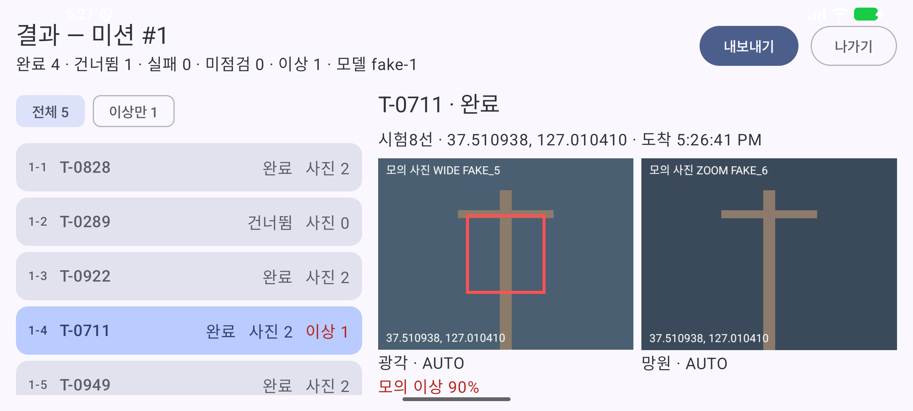
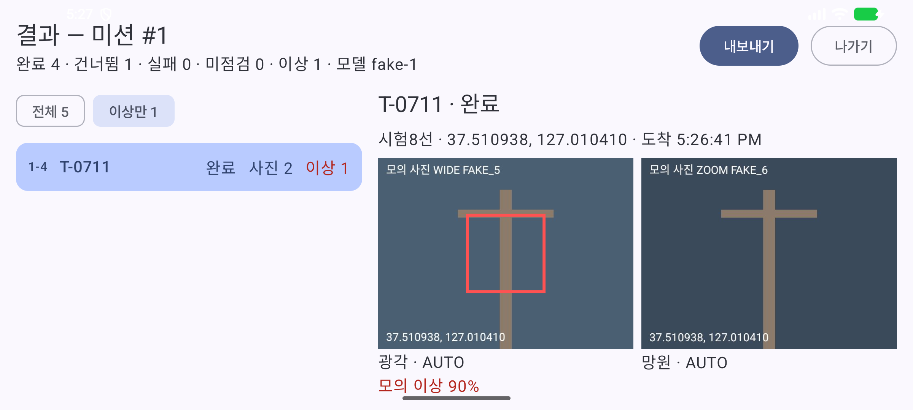

# 증빙: 결과 화면 ⑤와 내보내기 (2026-09-29)

- 대상: 커밋 `1833d41` 위의 변경
  - `ui/ResultScreen.kt`: 전주 목록, [전체]/[이상만] 필터, 사진과 탐지 박스, [내보내기]
  - `data/MissionExport.kt`: 미션 결과 ZIP(`result.csv` + `mission.json` + `images/`, F-16)
  - 들어가는 곳: 비행 화면 "미션 완료"의 [결과 보기], 프로젝트 카드의 [결과]
  - 모의 기체가 JPEG 사진을 돌려주고, 모의 탐지기(`FakeDetector`, `fake-1`)가 사진 5장마다 1장에 "모의 이상"을 낸다(10장).
- 기체: `FakeDroneGateway`(모의 시간 ×5). 탐지 모델도 모의다. 실제 기체·모델은 쓰지 않았다.
- 환경: macOS(Apple Silicon), 에뮬레이터 `Pixel_8`(arm64, 2400×1080 가로), Android Studio JBR

## 1. 자동 테스트

| 종류 | 명령 | 결과 | 보고서 |
|------|------|------|--------|
| `:core` 단위 | `./gradlew :core:test --rerun-tasks` | 40개 통과, 실패 0 | [reports/core-unit/index.html](reports/core-unit/index.html) |
| `:app` 계측 | `./gradlew connectedDebugAndroidTest` | 6개 통과, 실패 0 | [reports/app-instrumented/index.html](reports/app-instrumented/index.html) |

새 계측 테스트 "결과_조회와_내보내기_ZIP"은 다음을 확인한다.

- 전주별 사진 수와 이상 수, 프로젝트의 마지막 미션 번호
- ZIP 항목(파일이 없는 사진은 JSON에만 남는다)
- CSV의 BOM, 쉼표와 따옴표가 든 건너뛴 이유의 따옴표 처리
- JSON의 사진 파일 경로와 탐지

## 2. 화면 스모크 시험

다시 실행하려면 에뮬레이터를 켜고 `./gradlew installDebug`를 실행한 뒤 `bash docs/evidence/2026-09-29-result/smoke.sh`를 실행한다. 약 3분 걸린다.

스크립트는 먼저 [비행 스모크](../2026-09-29-flight/README.md)를 그대로 돌려 전주 5개(1개 건너뜀)짜리 미션을 끝낸다. 그다음 결과 화면을 확인한다.

| 단계 | 확인한 것 | 화면 |
|------|-----------|------|
| 1. 결과 목록 | "완료 4 · 건너뜀 1 · 실패 0 · 미점검 0 · 이상 1 · 모델 fake-1". 전주마다 소티-순서, 상태, 사진 수, 이상 수 |  |
| 2. 이상 전주 | 광각·망원 사진 2장, 광각 사진에 빨간 탐지 박스와 "모의 이상 90%" |  |
| 3. [이상만] | 목록에 이상 전주 1개만 남는다 |  |
| 4. 내보내기 | SAF 저장 대화상자가 `poles-1000_mission1.zip` 이름으로 열린다(기본 폴더 Downloads) |  |
| 5. 저장 뒤 | "내보냈습니다: 전주 5개, 사진 8장" |  |
| 6. 다시 열기 | [나가기] → 계획 화면 → 프로젝트 목록 카드의 [결과]로 같은 결과가 열린다 |  |

## 3. ZIP·DB·기기 사진 대조

스크립트는 네 가지를 꺼내 [verify.py](verify.py)로 대조한다.

- SAF로 저장한 ZIP(`/sdcard/Download`)
- 앱 폴더 ZIP(4.3 `export/1.zip`)
- 기기 사진 폴더
- 앱 DB(`run-as`)와 앱 로그([export.log](export.log))

대조 항목 18개가 모두 일치했다.

```
일치: SAF로 저장한 ZIP = 앱 폴더 ZIP(export/1.zip)
일치: ZIP 항목 = result.csv + mission.json + 사진
일치: ZIP 사진 = 기기 사진(바이트 동일)
일치: 사진은 640×480 JPEG
일치: CSV는 UTF-8 BOM으로 시작
일치: CSV 머리글
일치: CSV 줄 = DB 방문(소티, 순서, 전주, 상태)
일치: CSV 건너뛴 이유 = DB
일치: CSV 사진 수·이상 수 = DB
일치: CSV 이상 라벨
일치: 완료 전주는 도착 시각이 있음
일치: JSON 미션 번호·상태·모델
일치: JSON 프로젝트 이름
일치: JSON 비행 파라미터 = DB
일치: JSON 전주·사진 수 = DB
일치: JSON 사진 파일은 ZIP 안에 있음
일치: JSON 탐지 = DB 탐지
일치: 앱 로그 전주·사진 수
전주 5개, 사진 8장, 탐지 1개, ZIP 66,781바이트
```

내보낸 `result.csv`는 [result-sample.csv](result-sample.csv)에 그대로 두었다. 엑셀에서 열면 한글이 깨지지 않는다(BOM).

## 4. 알려진 한계

- 결과 지도와 원본 일괄 다운로드는 없다. 기체 연동 뒤(4단계)에 붙인다(10장).
- 사진과 탐지는 모의다. 실제 탐지 모델을 넣으면 `FakeDetector` 대신 TFLite 탐지기를 쓴다.
- 프로젝트 카드의 [결과]는 가장 최근 미션만 연다. 미션이 여러 개일 때 고르는 화면은 아직 없다.
- 사진은 원본 해상도로 디코드한다. 실제 4K 사진이 많으면 축소 디코드가 필요하다.
