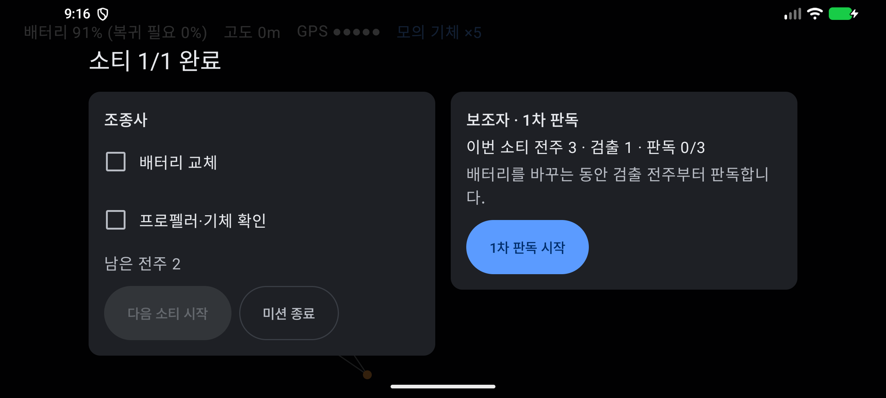
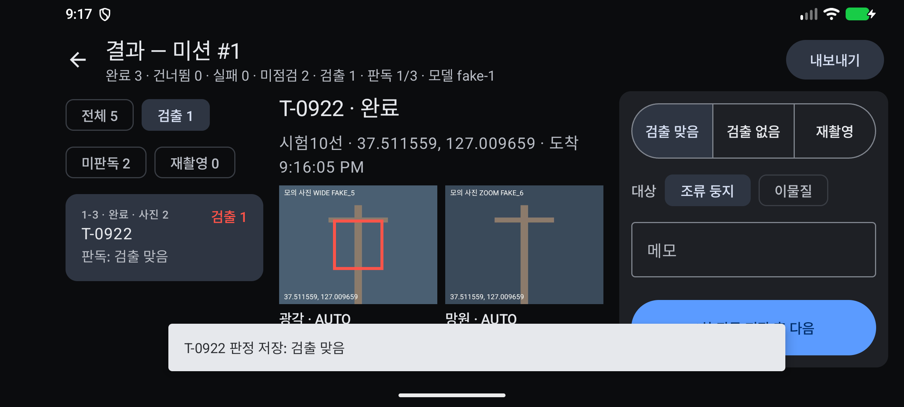
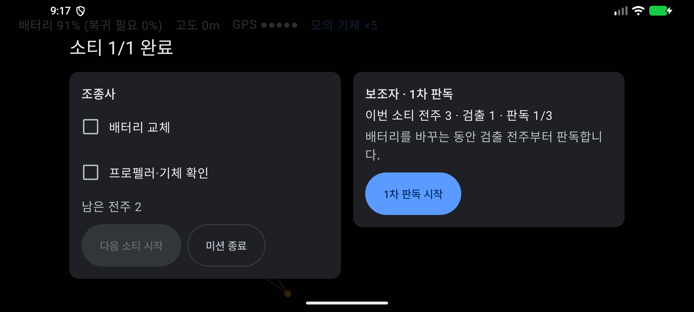
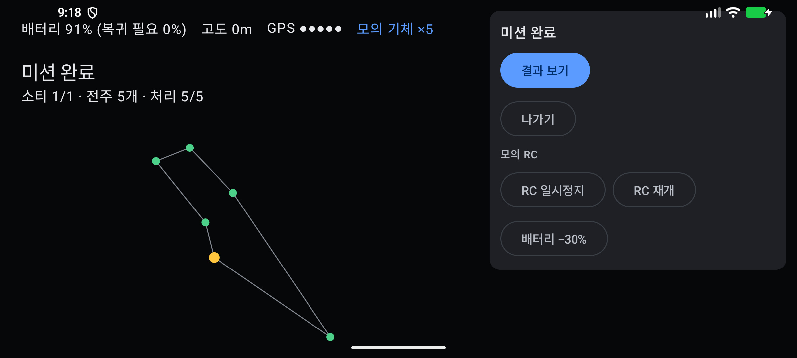
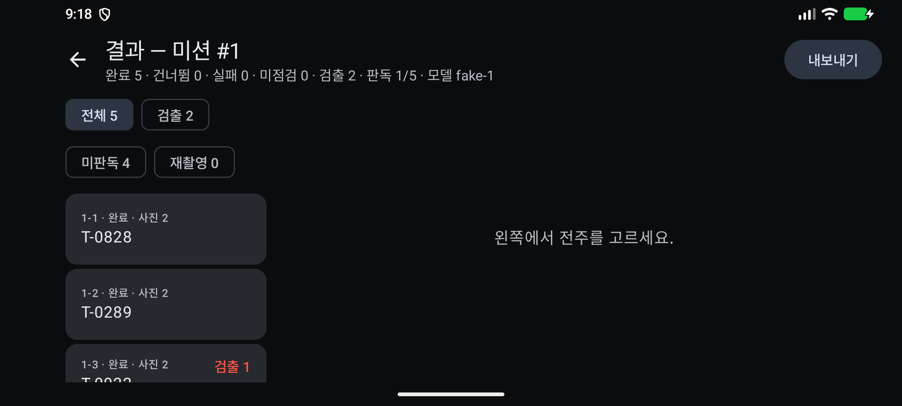

# 증빙: 비행 화면 ViewModel 전환과 소티 완료 화면(2인 운용) (2026-09-29)

- 대상
  - `ui/flight/FlightViewModel.kt`, `ui/flight/FlightScreen.kt`
    - 비행 화면의 로직(미션 읽기, 실행기 조립, 명령)을 `ViewModel`로 옮겼다.
    - 기체는 `droneFactory`로 받는다. 지금은 모의 기체이고, 연동하면 `DjiDroneGateway`로 바꾼다.
  - 소티 완료 화면
    - 왼쪽 조종사 칸: "배터리 교체", "프로펠러·기체 확인"을 체크해야 [다음 소티 시작]이 켜진다.
    - 오른쪽 보조자 칸: 이번 소티의 처리 전주·검출·판독 수와 [1차 판독 시작]
  - `MainActivity`: Navigation Compose로 화면을 이동한다.
    - 1차 판독 화면에 다녀오는 동안 비행 화면이 백 스택에 남아, 실행기가 멈추지 않는다.
    - 결과 화면의 `ViewModel`은 화면을 닫을 때 정리되므로, 다시 열면 최신 데이터를 읽는다.
  - 알림음(`sound/ToneNotifier.kt`)과 모의 사진(`data/FakePhotos.kt`)을 화면 파일에서 분리했다.
  - 색은 MD3 테마 역할을 쓴다. [재개]는 `tertiary`(초록), RTH는 `error`(빨강)이다(10.1).
- 기체: `FakeDroneGateway`(모의 시간 ×5). 탐지는 모의 탐지기(`fake-1`, 사진 5장마다 1장 조류 둥지)다.
- 환경: 에뮬레이터 `Pixel_8`(arm64, 2400×1080 가로)

## 다시 돌리기

```bash
./gradlew installDebug
bash docs/evidence/2026-09-29-sortie/smoke.sh     # 약 5분
```

## 시나리오와 결과

전주 5개를 계획해 비행한다. 3개를 처리한 뒤 다음 구간으로 이동하는 중에 [RTH (길게)]를 1.5초 눌러 소티를 끝낸다.

| 단계 | 확인한 것 | 화면 |
|------|-----------|------|
| 1. 소티 완료 | "소티 1/1 완료", "이번 소티 전주 3 · 검출 1 · 판독 0/3", "남은 전주 2". 체크하기 전에 [다음 소티 시작]을 누르면 아무 일도 일어나지 않는다. |  |
| 2. 1차 판독 | [1차 판독 시작]을 누르면 결과 화면이 [검출] 필터로 열린다(전주 1개). "조류 둥지 90%"에 [검출 맞음]을 저장한다. |  |
| 3. 비행 화면 복귀 | 뒤로 가면 소티 완료 화면이 그대로 있고, "판독 1/3"으로 바뀐다. |  |
| 4. 다음 소티 | 두 항목을 체크하고 [다음 소티 시작]을 누른다. 남은 2개를 점검한 뒤 미션 완료가 된다. |  |
| 5. 결과 | "완료 5 · … · 검출 2 · 판독 1/5". 두 번째 검출은 두 번째 소티의 10번째 사진이다. |  |

앱 DB와 알림음 로그 대조 결과([verify.txt](verify.txt))는 10개 항목이 모두 일치했다.

- 운용자 RTH 기록 1건, RTH 전에 처리한 전주 3개
- 소티 완료 다음이 같은 실행기의 비행 전 점검이다(새 실행기를 만들지 않았다).
- 상태 기록이 끊김 없이 이어진다. 판독 화면에 다녀와도 실행기가 유지됐다.
- 1차 판독 1건: 첫 소티의 검출 전주에 검출 맞음(`bird_nest`)
- 알림음: 도착 5, 검출 2, 점검 완료 3, 오류 0

## 함께 다시 돌린 시험

- [비행 스모크](../2026-09-29-flight/README.md): 21개 일치. `ViewModel`로 옮긴 뒤에도 같은 결과이고, 스크린샷을 다시 찍었다.
- [결과 스모크](../2026-09-29-result/README.md): 21개 일치

## 알려진 한계

- 소티 완료 화면의 소티 번호는 실행기가 소티를 다시 시작하는 방식 때문에 "소티 1/1"로 나온다. RTH로 일부만 처리하면 같은 소티를 이어서 비행한다.
- 확인 항목은 화면에서만 체크한다. 체크 기록은 DB에 남기지 않는다.
